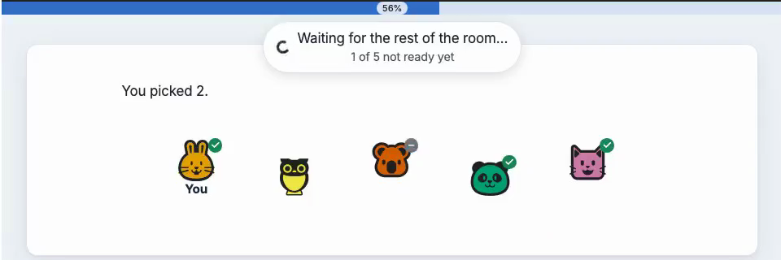

=============================
Groups and barriers in detail
=============================

A :class:`~psynet.sync.Grouper` forms groups of participants, and a
:class:`~psynet.sync.GroupBarrier` makes the members of a group wait for each
other. The ``rock_paper_scissors`` demo pairs participants and plays three
synchronized rounds:

.. literalinclude:: ../../../demos/experiments/rock_paper_scissors/experiment.py
   :pyobject: get_timeline

Forming groups
--------------

:class:`~psynet.sync.SimpleGrouper` waits until enough participants are
waiting, then randomly splits them into groups. Participants stay on their
current page, under a waiting indicator, until their group is formed, unless
the grouper has a ``waiting_screen`` (see below).

``group_type``
    A label for the groups. Barriers and trial makers refer to the groups by
    this label.

``initial_group_size``
    The size of each new group. Required.

``batch_size`` (default: ``initial_group_size``)
    How many participants must be waiting before groups are formed. A larger
    batch lets you form several groups at once from the same pool.

``quorum`` (default: ``start_short_with``, or else ``initial_group_size``)
    How many active members a group needs to keep going. A group whose
    members fail or leave until it has fewer is below quorum: it cannot pass
    a barrier, and waits for newcomers or is dissolved (see
    `Groups below quorum`_). For groups of three or more, leaving it out
    warns, so that you decide how many may drop out. ``min_group_size`` is
    a deprecated name for it.

``join_existing_groups`` (default: ``False``)
    If ``True``, an arriving participant first joins an existing group that
    is below ``max_group_size``, preferring the smallest and then the oldest
    group. Pending members (see :ref:`sync-admission-points`) count towards
    a group's size here. Participants already waiting at the grouper join such a group on
    the next barrier check after one has room. Groups that have closed or
    stopped accepting top-ups, and groups with no active members, are not
    joined. Groups formed with this option accept *top-ups* until you stop
    them; see `Groups below quorum`_ for how they stop, and for what they
    change when a member drops out.

``use_admission_points``
    When a participant who joins an existing group starts taking part in it.
    Required with ``join_existing_groups=True``; leaving it out warns and
    uses ``False``. ``False`` makes them a member at once, which
    suits a lobby whose game hasn't started. ``True`` makes
    them a *pending member* until the group's next admission point; see
    :ref:`sync-admission-points`.

``target_group_size``
    Required with ``use_admission_points=True``, between
    ``quorum`` and ``max_group_size``. An admission point that would leave
    the group with fewer members waits up to ``top_up_wait`` for newcomers
    (without a limit if ``top_up_wait`` is ``None``). Set it to the
    ``quorum`` not to wait.

``max_groups`` (default: ``None``)
    The most groups of this grouper that may be active at once. Once it is
    reached, participants wait at the grouper for room in an existing group.

``max_group_size`` (default: ``initial_group_size``)
    The largest size a group can reach through ``join_existing_groups``;
    ``None`` means no limit. Setting it to anything else requires
    ``join_existing_groups=True``. The limit holds when several participants
    try to join at once: joins to one group take turns, and a participant
    who finds a group busy tries the next suitable group, or waits at the
    grouper and tries again shortly. If every suitable group is busy when a
    newcomer arrives, their own request waits up to a second for the best
    one before falling back to the grouper; joins made by a barrier check
    never wait.

``join_criterion``
    A function of ``group`` and ``participant`` that returns whether the
    participant may join that group. Only used with
    ``join_existing_groups=True``. Returning ``False`` only turns that
    newcomer away; the group keeps accepting top-ups (see
    `Groups below quorum`_).

``start_short_after`` (default: ``None``)
    Seconds after which a smaller group may start. Once the longest-waiting
    participant has waited this long and at least ``start_short_with`` are
    waiting, those waiting form a group even if there are fewer than
    ``batch_size``. Needs ``quorum`` or ``start_short_with``, and a
    ``max_wait_time`` (default 20 seconds) longer than ``start_short_after``.
    A ``{SECONDS}`` placeholder in ``waiting_message`` counts down to that
    short start once ``start_short_with`` are waiting; until then the
    participant sees "Waiting for other participants…", or what
    :ref:`a message function <sync-countdown-messages>` returns.

``start_short_with`` (default: ``quorum``)
    The smallest group a short start may form. Leave it unset to start short
    at the quorum; pass a larger value to require more members than the
    quorum before a short start. If you pass it without ``quorum``, the
    quorum defaults to it; the quorum may not be larger, so that a group
    started short is not below quorum at its first barrier.

    With ``join_existing_groups=True``, later arrivals can fill a group
    started short up; see `Groups below quorum`_ for what top-ups change
    when a member then drops out.

``max_wait_time`` (default: 20) and ``max_wait_action`` (default: ``"fail"``)
    How long a participant may wait for a group, and what happens then:
    ``"fail"`` fails them, and ``"continue_without_group"`` lets them carry
    on without one (see `Timeouts`_).

``waiting_message``
    The message on the waiting indicator. If omitted, participants see
    "Waiting for other participants…". For translated experiments, mark it as
    described in :doc:`/code/participants/internationalization`.

``id_`` (default: ``{group_type}_grouper_{initial_group_size}``)
    Groupers with the same ID share one pool of waiting participants.

The ``gibbs_within_sync`` demo tops up groups of three, but only while the
leader has more than one trial left:

.. literalinclude:: ../../../demos/experiments/gibbs_within_sync/experiment.py
   :start-at: SimpleGrouper(
   :end-before: trial_maker,
   :dedent: 8

.. literalinclude:: ../../../demos/experiments/gibbs_within_sync/experiment.py
   :pyobject: is_group_joinable

The ``crowd_estimate`` demo starts groups short and tops them up until its
game starts; :ref:`sync-lobby-top-ups` shows its grouper.

Groups are formed only from participants who are waiting at the same time,
so recruitment must bring them in close together. A participant who waits at
a grouper for longer than ``max_wait_time`` (default 20 seconds) is failed,
or continues without a group with ``max_wait_action="continue_without_group"``;
raise ``max_wait_time`` if participants arrive slowly.

Accessing the group
~~~~~~~~~~~~~~~~~~~

Each group is a :class:`~psynet.sync.SyncGroup`. Inside a trial,
:attr:`Trial.sync_group <psynet.trial.main.Trial.sync_group>` returns the
group of the trial maker's ``sync_group_type`` (or, for a cued trial, the
trial class's) that the trial was played in. Elsewhere, use
``participant.sync_group`` if the participant is in one active group, or
``participant.active_sync_groups[group_type]`` if they are in several.
``participant.in_sync_group(group_type)`` tells whether they are still in a
group of that type.

A :class:`~psynet.timeline.PageMaker` builds its page again when the
participant submits it, and by then they may have left their group. Read
the group with ``participant.active_sync_groups.get(group_type)``, which
returns ``None`` once they have left, rather than indexing it, which raises
a ``KeyError``, and build the page without the group in that case. To keep
using a value from the group, such as a chat room ID, store it in a
participant variable when the page is first built.

``sync_group.participants`` is a read-only list of the group's members; change
membership with ``sync_group.add_participant(participant)`` and
``sync_group.remove_participant(participant, reason)``, where ``reason``
says why they left (see
:meth:`~psynet.participant.Participant.sync_group_removal_reason`); in a timeline,
:func:`leave_group(group_type) <psynet.sync.leave_group>` takes the
participant out of their group of that type, for example after their last
round. The list has no guaranteed
order. When you need a stable one, for example to assign roles or turns,
use :func:`group_seats(group) <psynet.sync.group_seats>`, which numbers
everyone who has been in the group by when they joined, and keeps the
numbers when members leave (see the ``story_chain`` demo).
``sync_group.leader`` is the group's leader.

.. _sync-regrouping:

Regrouping
~~~~~~~~~~

A participant can be in groups of different ``group_type`` at the same time,
but in only one group of each type. To regroup participants, close the group
with a :class:`~psynet.sync.GroupCloser` and place another grouper with the
same ``group_type``. A ``GroupCloser`` is a group barrier, so members wait
there for each other; the end of the timeline needs none, because a group
whose members have all finished closes by itself. The ``group_closer`` feature demo forms groups of three,
then groups of two, and assigns roles at a barrier each time:

.. literalinclude:: ../../../demos/features/group_closer/experiment.py
   :start-at: timeline = Timeline(
   :end-before: test_n_bots
   :dedent: 4

.. literalinclude:: ../../../demos/features/group_closer/experiment.py
   :pyobject: assign_roles

Two groupers of the same type and size share a default ID, and so a waiting
pool. Give them different ``id_`` values if they should not.

.. _sync-regrouper-recipe:

Rounds with changing groups
~~~~~~~~~~~~~~~~~~~~~~~~~~~

If the same group plays every round, you need no regrouper: form the group
once with a :class:`~psynet.sync.SimpleGrouper` and make the round loop's
body one cued trial whose ``show_trial`` contains the
:class:`~psynet.sync.GroupBarrier` objects (see :ref:`rounds-cued-trials`). Use a
regrouper when each round should form new groups, for example new pairs
within a cohort.

In games played over many rounds, a participant who is slow in one round
should not hold up everyone else, and should not be failed either. A
:class:`~psynet.sync.Regrouper` placed at the start of each round handles
this. Each time a participant reaches it, they leave their previous group of
that type and wait for the next round. The regrouper then splits everyone
waiting into new groups, when every member of the participant's ``within``
group (such as their cohort) is waiting, or when ``deadline`` passes, without
whoever isn't ready yet, provided enough participants are waiting to form a
group. Latecomers join the next round. The groups it forms are
never dissolved when a member leaves, so the members who are left continue
the round on their own.

.. code-block:: python

    pairing = Regrouper(
        "pair",
        within="cohort",
        roles=["proposer", "responder"],
        deadline=50,
        left_over="sit_out",  # an odd player out sits the round out
    )

By default, players are grouped at random, those who have played the most
rounds sit out when not everyone fits, and roles are shuffled across each
group's members. Override :meth:`~psynet.sync.Regrouper.form_groups` for
other grouping rules and :meth:`~psynet.sync.Regrouper.assign_roles` for
other role rules. The ``ultimatum_pairing`` demo overrides both, to keep
last round's partners apart and to give each role to whoever has held it
least often, so that roles alternate. Its ``pairing.py`` defines:

.. literalinclude:: ../../../demos/experiments/ultimatum_pairing/pairing.py
   :pyobject: PairingRegrouper

.. literalinclude:: ../../../demos/experiments/ultimatum_pairing/pairing.py
   :pyobject: is_rematch

.. literalinclude:: ../../../demos/experiments/ultimatum_pairing/pairing.py
   :pyobject: last_partner_id

.. literalinclude:: ../../../demos/experiments/ultimatum_pairing/pairing.py
   :pyobject: times_held

The regrouper counts each participant's rounds: :meth:`~psynet.sync.Regrouper.rounds_played`,
:meth:`~psynet.sync.Regrouper.rounds_sat_out`,
:meth:`~psynet.sync.Regrouper.sat_out` (for the latest round). With
``roles``, a cued trial reads its player's role in that round as
:attr:`~psynet.trial.main.Trial.sync_group_role`.

When the cohorts take latecomers (``join_existing_groups=True`` on their
grouper), ``stop_top_ups_after_rounds=n`` lets them join only during
the cohort's first ``n`` rounds: the next split, even one in
which everyone waiting sits out, stops the cohort's top-ups (see
:ref:`groups_below_quorum`). A cohort below its quorum at that split is
dissolved instead, with nobody grouped; with the cohort grouper's
``below_quorum="continue_without_group"``, its waiting players are released
ungrouped, without calling ``on_release``.
Every split that forms groups in the cohort counts as a round, even one that
pairs only latecomers while the others are still playing.

Play each round as one trial per player, added after the regrouper with
:meth:`Trial.cue() <psynet.trial.main.Trial.cue>` on a trial class that sets
``sync_group_type``. The trials of a group's members in one round share a
:class:`~psynet.sync.SyncGroupRound` for the group's results, and each
trial records the group, the player's role and the round, so the game needs
no bookkeeping of its own and its data can be exported from trials and
rounds (see :ref:`rounds-one-trial-per-player`).

:doc:`writing_a_round_based_experiment` builds a complete game this way, including moving
slow players on and sitting out. :class:`~psynet.sync.Regrouper` lists all
its settings, for example rounds on fixed ticks (``every``) and custom
grouping.

``waiting_message`` sets the message on the waiting indicator. A ``{SECONDS}``
placeholder shows a live countdown to the deadline, for example ``"The next round starts in {SECONDS} s."``.
Only waits with a release time can count down: a regrouper with ``deadline``
or ``every``, and a :class:`~psynet.sync.SimpleGrouper` with
``start_short_after``. A ``{SECONDS}`` placeholder in a fixed message
anywhere else raises an error; a message function that returns one there
shows "…" instead of a number.

.. _sync-countdown-messages:

**Countdown messages.** Sometimes the barrier doesn't know yet when the
wait will end, for example while a participant waits alone for a partner.
Then ``{SECONDS}`` shows "…", or a :class:`~psynet.sync.SimpleGrouper`
shows "Waiting for other participants…" in place of a fixed message. To show different text then, pass a
module-level function as ``waiting_message``. It receives ``seconds_left``, which
is ``None`` while the time is unknown and otherwise the whole seconds left
(0 once the time has passed), and can also take ``participant`` and
``barrier``. For a live countdown, return the literal ``{SECONDS}``
placeholder rather than writing ``seconds_left`` into the text, which would
stay fixed until the function is next called. The message switches within a
few seconds of the time becoming known:

.. code-block:: python

    def round_message(seconds_left):
        if seconds_left is None:
            return "Waiting for another player."
        return "The next round starts in {SECONDS} s."

Keeping a group in step
-----------------------

Barriers
~~~~~~~~

A :class:`~psynet.sync.GroupBarrier` holds each member until every active
member of the group has reached it. When the last member arrives, the barrier
calls ``on_release`` for the whole group. It waits for every active member
wherever the barrier is, so a member stops being waited for only by leaving
the group (see :ref:`sync-leaving-a-group`), and members who wait at
different barriers of one group wait for each other, which PsyNet reports
as an error (see :ref:`group barriers in loops
<rounds-group-barriers-in-loops>`). In ``rock_paper_scissors`` the
barrier after each choice scores the round and saves on each player's
trial the action they played, their partner's action and the result,
where ``show_feedback`` reads them:

.. literalinclude:: ../../../demos/experiments/rock_paper_scissors/experiment.py
   :pyobject: RockPaperScissorsTrial.show_trial

.. literalinclude:: ../../../demos/experiments/rock_paper_scissors/experiment.py
   :pyobject: RockPaperScissorsTrial.score_round

``on_release`` can take any of the arguments ``group``, ``participants``,
``trials`` (each member's current trial, in the same order as
``participants``; its ``answer`` holds the answer so far), ``group_round`` (see
below), ``leader`` and ``barrier`` (``participant`` is the leader too, kept
for compatibility).

.. _sync-barrier-round:

``group_round`` is the group's :class:`~psynet.sync.SyncGroupRound` whose
trial every member it releases is in, that is, at a barrier in
``show_trial`` of a cued trial with ``sync_group_type`` (see
:ref:`whom a group barrier waits for <rounds-group-barrier-rule>`). At any other barrier, including one in ``show_feedback``, between
iterations, after the loop or at the start of a later run, and in a group
that plays no rounds, ``group_round`` is ``None``
and ``trials`` holds each member's current trial whatever its round, which
can be a trial of an earlier round or module, or ``None`` for a member with
none.
In ``rock_paper_scissors`` the barrier is in ``show_trial`` of a cued
trial, so ``group_round`` is the pair's round. The demo saves the
results on the trials, but a ``@classmethod`` on the trial class can also
save the group's results in ``group_round.var`` (see :ref:`rounds-one-trial-per-player`). Results on
the trial or round stay in the export for every round, while a participant
variable keeps only the latest. ``on_release`` must be a module-level
function, a static or class method, or a method bound to a trial maker or a
saved database object such as a trial. The ``barrier`` it receives is rebuilt
from saved settings, so read only scalar settings such as ``waiting_message`` and
``max_wait_time`` from it, and store custom barrier attributes as
JSON-compatible values. Closures and lambdas can't be saved, so to share one
callback between barriers, give each barrier its own arguments with
:func:`functools.partial`. Pass them by keyword, as JSON-compatible values
named in the function's parameters; they take precedence over arguments of
the same name that PsyNet passes:

.. code-block:: python

    from functools import partial

    def score_question(group, question):
        ...

    GroupBarrier(id_="question_1", group_type="team",
                 on_release=partial(score_question, question=1))

``on_release`` can also take ``left``, the members who left the group since
its previous barrier pass (or since it formed), ordered by participant ID;
``participant.sync_group_removal_reason(group_type)`` says why each went, for
example to tell a player whether their partner returned the study or was too
slow. ``trials`` only covers the members still in the group;
``group_round.trials`` lists every trial of the round, including those of
members who have since left, each with its ``sync_group_role``.

.. _sync-timeouts-and-rounds:

:attr:`trial.time_limit_reached <psynet.trial.main.Trial.time_limit_reached>`
says whether a member's latest timed page ran out of time before their
answer, so ``on_release`` can score a timed-out answer differently. It is
exported with the trial. The trial keeps it through later untimed pages and
barrier waits, including timed pages shown while waiting at a barrier, and
through the trial's feedback pages, such as a notice whose time limit only
moves it on. Feedback pages also don't count when the next barrier records
who ran out of time, so a time-out on the trial still shows there after its
feedback. Elsewhere in a group's timeline, give a page a ``time_limit`` only
when running out of time is a real outcome: any other page that ends on its
time limit marks the member as having run out of time at the next barrier.
To move members on from a notice automatically, show it from the trial's
``show_feedback``.

To read a group's rounds after the game, for example on a
debrief page once the group has ended,
:meth:`group.rounds(module_id) <psynet.sync.SyncGroup.rounds>` returns the
group's rounds in that module in round order:

.. code-block:: python

    def score_round(trials, group_round):
        for trial in trials:
            trial.score = 0 if trial.time_limit_reached else trial.answer
        ...

    def story_so_far(group):
        return [r.var.get("sentence") for r in group.rounds("story")]

.. _sync-round-outcome:

Each trial in a group's round records how the round ended for its player in
:attr:`~psynet.trial.main.Trial.sync_group_outcome`, so that feedback pages
and exports can read it rather than work it out from the player's groups
later:

- ``"stayed"``: a group barrier in the trial's pages (``show_trial``)
  released the group with the player in it. After that the outcome doesn't
  change. Barriers after the trial, such as in ``show_feedback``, don't
  store it, and members who skipped the round get nothing;
- why the player left the group before such a release: a reason of
  :meth:`~psynet.sync.SyncGroup.remove_participant`, for example
  ``"late"``, ``"waited_too_long"``, ``"left_experiment"``,
  ``"group_dissolved"`` or ``"removed_by_experimenter"`` (the values are listed in
  :data:`~psynet.sync.SyncGroupOutcome`);
- ``None`` before either happens, and for a trial played without a group.

The outcome is only written during the trial's pages (``show_trial``), while
:attr:`~psynet.trial.main.Trial.complete` is ``False``, and only until a
barrier there releases the group with the player in it. So ``"stayed"``
means the player took part in the round's first release, not that they
stayed to the end of its pages: ``complete`` and
``participant.sync_group_removal_reason(group_type)`` say that. A player who
leaves later, for example by being late at a second barrier of the round,
keeps ``"stayed"``; when that barrier releases the rest, its ``on_release``
lists them in ``left``, so store there what it decides about them.
Leaving the group in ``show_feedback``, between rounds or in a later
module stores nothing either, so put the barrier that decides the round in
``show_trial``. A partner's outcome is on their trial in
``self.group_round.trials``:

.. code-block:: python

    def show_feedback(self, experiment, participant):
        if self.sync_group_outcome == "late":
            return InfoPage("You were away for too long, so you missed this round.")
        partners = [t for t in self.group_round.trials if t.id != self.id]
        partner_left = any(
            trial.sync_group_outcome not in (None, "stayed") for trial in partners
        )
        ...

A member removed before their cue ran has no trial in the round; ``left``
still lists them.

``on_release`` runs only when the barrier releases the group. A member who
leaves the group before then, or whose group is dissolved, doesn't get
the results it would have stored, so read them with ``.get``, which returns
``None`` when they aren't set: ``trial.var.get("score")`` for results saved on
the trial, or ``participant.var.get("score")`` when there is no trial.

.. _sync-dissolved-round:

No code of yours runs when a group dissolves, but PsyNet records it on the
round: the group's :class:`~psynet.sync.SyncGroupRound` gets
``dissolved_at``, the time
it dissolved, if a member still in the group was in their trial in that
round (its pages hadn't ended) and the round wasn't closed.
A round that a barrier released stays ``None``, even if a member was still
on a page after the barrier, and so does a round whose remaining members'
trials had all ended, as when the group dissolves between rounds. Likewise,
the trials of members released by the barrier keep ``sync_group_outcome``
``"stayed"``. So an export can tell a cancelled round from one still in
progress even if no member finishes their trial, for example
``group_round.dissolved_at is not None``, without storing anything of
its own.

With ``below_quorum="continue_without_group"`` the members carry on and the
round's results are still stored (with ``"fail"``, the members
are failed and ``show_feedback`` doesn't run). Each trial's ``answer`` holds
the player's latest answer, the round's trials are in ``group_round.trials``,
and each trial's ``sync_group_outcome`` is
``"group_dissolved"`` for every member still in the group when it dissolved,
waiting at the barrier or still on a page, unless the trial's pages had
already ended or a barrier had already released the round (see
:ref:`round outcomes <sync-round-outcome>`).
If ``show_trial`` has pages after the barrier, set ``accumulate_answers =
True`` on the trial class and read the answer given before the barrier by
its page label, for example ``trial.answer["estimate"]``, so a later page
doesn't replace it.
Members who were waiting at the barrier pass it at once, and so do those
still on an earlier page, such as the question itself. Code that needs the
round's result, such as ``show_feedback``, an export or ``on_finalized``,
computes it from those facts when ``on_release`` didn't run. A partner who
was still on the question page may not have answered yet when a member's
``show_feedback`` runs, so a result that must be the same for the whole
group belongs in the export, or in code that runs once every trial in the
round is complete. A quiz can still score the last question for those who
answered it. With ``accumulate_answers``, an unanswered trial's ``answer`` is
``{}`` (without it, ``None``), so skip the missing estimates.
``group_round.trials`` includes the failed trial of a member who left;
leave out failed trials to drop their answer:

.. code-block:: python

    accumulate_answers = True

    def show_feedback(self, experiment, participant):
        score = self.var.get("score")
        if score is None and self.sync_group_outcome == "group_dissolved":
            alive = [t for t in self.group_round.trials if not t.failed]
            estimates = [t.answer.get("estimate") for t in alive]
            score = score_answers([e for e in estimates if e is not None])
        ...

In the ``public_goods`` demo, a group of three plays on with two, so the
group dissolves when one player is left and the round is cancelled.
``score_answer``, at the end of each trial, pays the last player for the
cancelled round by their trial's outcome:

.. literalinclude:: ../../../demos/experiments/public_goods/experiment.py
   :pyobject: ContributionTrial.score_answer

If the barrier that didn't release is after ``show_trial``, for example in
``show_feedback``, or comes after another barrier that released the round,
the trial's outcome isn't updated, because it is only written during the
trial's pages and until their first release, so check
``participant.sync_group_removal_reason(group_type) == "group_dissolved"``
instead.

The barrier ``id_`` identifies one waiting point. Barriers with the same ID
share a waiting pool, so give barriers with different ``on_release``
callbacks different IDs. Using one ID for barriers with different behavior
(class, ``on_release`` or release settings) raises an error when the
experiment is built. Waiting settings such as ``max_wait_time``,
``max_wait_action`` and ``waiting_message`` may differ, because each applies
to the participant who waits.

Arrival notices
~~~~~~~~~~~~~~~

While a member waits at a barrier, members who have not reached it yet see a
notice on the progress bar ("Your partner is ready.", or
"{ARRIVED}/{TOTAL} of your group are ready."). In groups of three or more,
the waiting indicator also has a smaller second line saying how many members
are not ready yet. Pass ``on_arrival_message`` to change the notices, or
``on_arrival_message=None`` to turn them all off. It receives ``kind``
(``"notice"`` for the progress bar, ``"late"`` for the notice a member
sees after being removed for being late, ``"waited_too_long"`` for the one
on the next page of a member removed after waiting too long), ``waiting_count`` and
``group_size``, and returns the text or ``None`` to hide it. For a notice it
is called whenever the browser fetches the current count, which can be
several times per arrival, so it should depend only on its arguments and
have no side effects. Notices must fit on two lines of a phone screen:

.. code-block:: python

    def arrival_message(*, kind, waiting_count, group_size, **kwargs):
        if kind == "late":
            return "Your partner went on without you. Please continue."
        if kind == "waited_too_long":
            return "Your partner didn't arrive in time. Please continue."
        return "Your partner is ready."

    GroupBarrier(
        id_="round_finished",
        group_type="rock_paper_scissors",
        waiting_message="Waiting for your partner",
        on_arrival_message=arrival_message,
    )

Pages with a :class:`~psynet.group_prompt.GroupPrompt` that ticks members
live don't show the notice, since the ticks say the same.

``waiting_message`` can also be a module-level function of the participant, so that
members waiting at the same barrier see different messages, for example by
role (it can also take ``seconds_left``; see :ref:`countdown messages <sync-countdown-messages>`):

.. code-block:: python

    def waiting_text(participant):
        if participant.var.role == "proposer":
            return "Waiting for your partner to accept or reject your offer…"
        return "Your partner is deciding how much to offer you…"

    GroupBarrier(id_="decided", group_type="pair", waiting_message=waiting_text)

A ``waiting_message`` function on a group barrier can also take ``waiting_count`` and
``group_size`` (both ``None`` if the participant has no group); return
:func:`~psynet.sync.hold_message` from it to write the second line yourself,
or to leave it out:

.. code-block:: python

    from psynet.sync import GroupBarrier, hold_message

    def waiting_text(waiting_count, group_size):
        return hold_message(
            "Waiting for the rest of the room…",
            f"{waiting_count} of {group_size} have chosen",
        )

    GroupBarrier(id_="chosen", group_type="room", waiting_message=waiting_text)

By default the participant's last page stays on screen, greyed out, while
they wait. To show something else instead, pass ``waiting_screen``; to give
them something to do, such as filler trials, pass ``waiting_logic``
instead. A waiting screen can be text,
a prompt, or a :class:`~psynet.modular_page.ModularPage` without a Next
button (``NullControl(show_next_button=False)``), or a module-level
function that returns one of these, or ``None`` to keep
the last page. The function can take ``participant``, ``trial``, the
participant's current trial, and ``group_round``, that trial's
:class:`~psynet.sync.SyncGroupRound` (``None`` if it is in no group's round),
asking for them by name as ``on_release`` does. At a grouper or
:class:`~psynet.sync.Regrouper`, ``trial`` is the participant's previous
trial, such as the previous round's, because ``current_trial`` only changes
when the next trial is cued.
The participant can't submit a waiting screen, so a page
with a Next button, push buttons or ``auto_advance`` raises an error; use
a control that doesn't submit, such as ``NullControl``. Groupers and :func:`~psynet.page.wait_while` take ``waiting_screen`` too,
for example to replace the instructions while a cohort forms. A barrier
without a waiting screen (or one whose function returns ``None``) that
follows another barrier's waiting screen shows a plain waiting page, since
the last page is no longer on screen. In the following example, the barrier
is inside a trial's ``show_trial``, and the participant's own choice, read
from their trial's answer so far, replaces the buttons they chose
it with.
``show_progress=False`` hides the answer ticks, which are of little use
in a pair, where the partner's arrival releases the barrier at once:

.. code-block:: python

    def your_choice(participant, trial):
        return GroupPrompt(
            f"You offer {trial.answer} coins.",
            participant=participant,
            group=trial.sync_group,
            show_progress=False,
        )

    GroupBarrier(
        id_="decided",
        group_type="pair",
        waiting_message="Waiting for your partner…",
        waiting_screen=your_choice,
    )

.. _sync-showing-the-group:

Showing the group
~~~~~~~~~~~~~~~~~

:class:`~psynet.group_prompt.GroupPrompt` shows the members of a small group
by their pseudonyms (see :doc:`pseudonyms`), with the participant viewing the
page labelled "You". Each member appears as their pseudonym animal, drawn
in their colour. ``names`` decides how the other members are named: by
pseudonym, read out by screen readers and shown on hover (``"on_hover"``,
the default), also written below the animals (``"shown"``), or not by
pseudonym at all (``"anonymous"``), every member then being drawn as the
same grey figure, labelled below with "Your partner" in a pair and "Another
player" in a larger group.
Use ``"anonymous"`` when partners must not recognise each other across
rounds, with ``ChatRoom(names="anonymous")`` if the page has a chat room.
Members sit in a row for up to four people and in a zigzag across the
width of the page for more, so the display adapts to any screen.

A page shows either progress or answers. On a decision page, members who
have answered get a tick. A member has answered once they wait at a barrier
of the group, typically the barrier
after the decision page. A member who reached the barrier because their
page's time limit ran out gets a grey dash instead
(:func:`~psynet.sync.reached_barrier_after_time_limit`), and screen readers announce
that they ran out of time. Pass ``show_progress=False`` to
hide the ticks.

A page without ``answers`` updates live: ticks and dashes appear as members
arrive at the group's barriers (this uses the barriers' arrival updates, so
it doesn't work with ``on_arrival_message=None``), and members appear as they join and disappear
as they leave. A page with ``answers`` is fixed when it loads. Live redraws
need the same ``FLASK_SECRET_KEY`` on every web process; without one, PsyNet
logs a warning and the group stays as first drawn:

.. code-block:: python

    from psynet.group_prompt import GroupPrompt

    def choose_number(participant):
        return ModularPage(
            "choose",
            GroupPrompt("Pick a number.", participant=participant, group_type="room"),
            PushButtonControl(choices=[1, 2, 3, 4, 5]),
        )

After the barrier, pass ``answers`` to show each member's answer in a speech
bubble, as a dictionary from participant ID to answer; ``show_progress``
then defaults to ``False``, and passing ``show_progress=True`` with
``answers`` raises an error. A member whose answer is
``None``, for example because they ran out of time, keeps their seat
without a bubble. Participant variables
store dictionary keys as strings, so a dictionary read back from one can be
passed as it is; ``highlight`` takes string IDs too. Speech bubbles may
overlap a neighbour; hovering over or tapping a member brings their bubble to
the front. Answers are shown as text; pass :class:`~markupsafe.Markup` for
HTML such as an image. ``highlight`` marks members, with built-in styles for
``"winner"`` and ``"duplicate"``, and ``note`` adds a line of text below
the group (hidden, like the group, when there is no group to show). In the
``show_feedback`` of a cued trial:

.. code-block:: python

    choices = self.group_round.var.choices
    GroupPrompt(
        "The winning number was 2.",
        participant=participant,
        group=self.sync_group,
        answers=choices,
        highlight={pid: "winner" for pid, n in choices.items() if n == 2},
    )

Store the answers when the barrier releases, as the ``public_goods``
demo does on the round's ``group_round.var`` in ``on_release``, rather than reading them
from the group's current members: a member who has already moved on to the
next round is no longer in the group, and would disappear if the page is
reloaded.

Without ``group``, the prompt shows the participant's group of type
``group_type``. ``group_type`` can be left out only while a participant has
only ever been in groups of one type; otherwise, as in a cohort that pairs
its players each round, GroupPrompt raises an error rather than switch to
whichever group is left when a pair ends.

GroupPrompt draws members by two rules, both based on stored facts:

- The group's active members, on every page.
- On a results page, everyone in ``answers`` too, even after they left
  the group. A member who left is faded and labelled "(left)", unless
  they moved on, such as to next round's pair at a
  :class:`~psynet.sync.Regrouper`, or finished
  (``reason="moved_on"`` or ``"finished"`` in
  :meth:`~psynet.sync.SyncGroup.remove_participant`), so that a results
  page reads the same after a reload.

A participant who is no longer in the group, for example because a
barrier removed them for being late, sees only the text when the prompt
is given ``group_type``. The prompt then needs no special case on pages
that such a player may still reach, though the page's other content, such
as a round's outcome, may. ``group=self.sync_group`` in trial code is the
group the trial was played in, which the prompt shows even after the
player has left it.

Trial makers
~~~~~~~~~~~~

A trial maker with ``sync_group_type`` gives the whole group the same trials.
Each group has a randomly chosen leader. PsyNet assigns the leader's next node
as if the leader were taking the trial maker alone, and the other members get
trials on the same node.

The group starts each run of the trial maker together, also when a loop
repeats it: its trial preparation, a ``GroupBarrier`` before each trial,
initializes the members it releases who haven't started the run, so the
trial maker's ``init_participant`` runs there, not when the member enters
it. The first member initialized, normally the leader, makes the
run's choices (the participant group and the block order); the others copy
them. PsyNet stores them, and the group's current block, in the group's
``trial_maker_runs`` column, keyed by trial maker id, one entry per run. It
writes that column under the group's row lock, which custom code must take
only after any participant rows it locks (see :ref:`sync-group-lock-order`).
The trial preparation is an admission point (see
:ref:`sync-admission-points`): a pending newcomer is admitted there, and
then copies the current run's choices and block, as does a member promoted
to leader. Pass ``sync_group_newcomer_max_wait`` to the trial maker when
its group type admits newcomers at admission points. A member who loops
faster than the others waits for the whole group to start the next run.

The start of every trial is synchronized; add
:class:`~psynet.sync.GroupBarrier` elements inside the trial, as in
``show_trial`` above, to synchronize other points. Each trial records the
group, the member's role and the group's round, counted from 0, in
``sync_group_id``, ``sync_group_role`` and ``sync_group_round`` (see
:ref:`basic_data_groups`).

.. _trial-maker-rounds:

Each time the trial preparation releases the group with new trials, they
share a new :class:`~psynet.sync.SyncGroupRound` (``trial.group_round``),
including the trials of newcomers admitted there. A barrier's
``on_release`` in the trial gets it as ``group_round``, so it can store the
group's results once in ``group_round.var``, as the ``create_rate_sync``
demo does. Rounds are numbered per group and trial maker, continuing
across runs when a loop repeats the trial maker; a leader told to wait
gives the group no trials and uses up no number. A round closes, setting
its ``closed_at``:

- When a ``GroupBarrier`` in the trial releases the group while every
  member it releases is in the round's trial. Each released member's trial
  records ``sync_group_outcome="stayed"``.
- Otherwise, when the trial preparation next releases the group, which it
  also does at the end of the trial maker. The trials that members still
  in the group have completed record ``"stayed"``.

Leaving the group during the trial, and the group dissolving, are recorded
as for cued trials (see :ref:`sync-group-rounds`). :meth:`SyncGroup.rounds()
<psynet.sync.SyncGroup.rounds>`, given the trial maker's id, returns the
group's rounds of the trial maker.

``sync_group_waiting_message`` sets the waiting message for the trial maker's own
waits. Grouper and barrier waits use their own ``waiting_message``, so pass the
same text to each if the messages should match.

.. _rounds-cued-trials:

.. _sync-group-rounds:

Rounds of cued trials
~~~~~~~~~~~~~~~~~~~~~

This section is the reference for rounds played as one cued trial per
player, on a trial class that sets ``sync_group_type``, whether the groups
are fixed or formed anew each round. For a worked example, with the
group's results in ``group_round.var`` and the exports, see
:ref:`rounds-one-trial-per-player` in the round-based tutorial. For a group
that works through a stimulus set or a chain, use a trial maker with
``sync_group_type`` instead (see :ref:`concept_groups` for how to choose,
and :ref:`rounds of a trial maker <trial-maker-rounds>`).

``cue`` numbers each group's rounds by itself, from 0:

- A cue joins the group's newest round in the module while that round is
  open and the player has no trial in it. A round closes when a
  ``GroupBarrier`` releases the group while every member it releases is in
  the round's trial, that is, at a barrier in ``show_trial``, and only then.
- Otherwise it starts the group's next round.

So a group formed anew each round, such as a pair made by a
:class:`~psynet.sync.Regrouper`, plays only round 0, while a fixed group cued
in a loop plays rounds 0, 1, 2 and so on, whichever trial classes it cues.
A member who cues late joins the current round only until a barrier in
that round's trial releases the group. After that, even while the others
are still on a page after the barrier, their cue starts the next round,
which the others then join. So put a ``GroupBarrier`` in each round,
inside ``show_trial`` after the answer page: it keeps
the members in step, and its release closes the round. A round without
one would never close, so a member cueing late could join it after the
others have finished; PsyNet therefore raises an error when a grouped
trial's ``show_trial`` returns no ``GroupBarrier``. In a module that
a loop repeats, a member's first cue in the next run can also join the
previous run's last round while it is open, so end each round there with a
``GroupBarrier`` that closes it.

.. _rounds-group-barrier-rule:

A ``GroupBarrier`` waits for every active member of its group, wherever it
is: in ``show_trial``, in ``show_feedback``, at the start of each
iteration, between runs of a module or after the loop. Nobody is skipped
for being in another round or another module: a member stops being waited
for only by leaving the group, with :func:`~psynet.sync.leave_group` or by
being removed, for example as late (see :ref:`sync-leaving-a-group`). Every
release is the group's pass, except letting one member go after
``max_wait_time`` and letting the waiting members go because the group
dissolved below its quorum (see :ref:`groups_below_quorum`). A pass runs
``on_release`` and counts for ``left`` and ``late_after``; a dissolution
does neither and closes no round. If every member a pass releases is in
the same round's trial, the pass closes that round (setting its
``closed_at``) and ``on_release`` gets it as ``group_round``; otherwise
``group_round`` is ``None``. For example:

.. code-block:: python

    class EstimateTrial(Trial):
        sync_group_type = "team"

        def show_trial(self, experiment, participant):
            return join(
                self.estimate_page(),
                GroupBarrier(id_="estimates", group_type="team",
                             on_release=self.score_round),   # closes the round
                PageMaker(self.revise_page, time_estimate=10),
            )

    Module("game", for_loop(label="q", iterate_over=range(3),
                            logic=lambda q: EstimateTrial.cue({"q": q}, round=q)))

Pages between rounds, or between runs of a module that a loop repeats,
need nothing special, inside the module or outside it: a member who reads
slowly is waited for at the next barrier. A member who stops playing
earlier than the others, for example by choosing not to play another run,
should leave the group first, or the others wait for them at their next
barrier. :doc:`late_slow_and_leaving_players` follows these and other
cases, such as players leaving or reading slowly, step by step.

.. _rounds-group-barriers-in-loops:

Because each barrier waits for everyone, put the barriers where every
member reaches them in the same order. Members who wait at different
barriers wait for each other: none of them can pass until ``late_after`` or
``max_wait_time`` moves someone on, and ``late_after`` on either barrier
fails the members it waits for at the other, who were on time. The
background barrier check reports this within a second or so, however the
members got there: it records one error for the group and that set of
barriers, naming the barriers and who waits at each, logs it and lists it under the dashboard's Errors
tab. A bot test run by ``psynet test local`` then fails with a
:class:`~psynet.sync.GroupDivergenceError` and that message when it ends,
after its bots have finished or failed.

The usual way into this is a member who joins during the game. For a
fixed group that plays rounds, either stop top-ups before the game, with
``stop_top_ups=True`` on a barrier before the first round (see
:ref:`sync-lobby-top-ups`), or admit newcomers only at the start of a round,
with ``use_admission_points=True`` (see
:ref:`sync-admission-points`). Without admission points a newcomer is a member
like any other once they join, and every barrier waits for them, also one
they reach after the group has gone, such as one before a separate module
of rounds (see :ref:`sync-newcomers-at-passed-barriers`).

A trial has two round counters. ``sync_group_round`` counts the group's
rounds, and is ``None`` on a trial played without a group. Use it for what
the group shares, such as what a round shows and the group's rows in the
export. ``trial.position`` counts the player's own trials in the
module, grouped or not. Use it for the player's own sequence, such as the
round in a per-player export when groups change every round. The two agree
only in a fixed group that every member joined before the loop. In a fixed
group's loop with ``round=`` (below), ``sync_group_round`` is the loop
value.

Every trial in a round gets the definition of the round's first cue. With
a regrouper, a definition taken from the player's own position in the loop, as in
``logic=lambda i: OfferTrial.cue({"block": i})``, would fail: a pair that
the regrouper forms from players at different rounds would cue two
definitions for one round and get a ``ValueError``. Pass a function
instead: it runs once per round, for the round's first cue. A regrouper's
groups play only round 0, so take what varies from ``group``, such as
``OfferTrial.cue(lambda group: {"seed": group.id})``, or draw it at random in
the function. A round with no content
of its own needs no definition: ``OfferTrial.cue()`` gives every trial
``{}``.

.. _rounds-fixed-group-loop:

A fixed group that plays a loop of rounds together should pass the loop
value as ``round=``:

.. code-block:: python

    for_loop(
        label="questions",
        iterate_over=range(len(QUESTIONS)),
        logic=lambda i: EstimateTrial.cue({"question": i}, round=i),
        time_estimate_per_iteration=EstimateTrial.time_estimate,
    )

Each iteration is then the group's round of that number, whoever cues it
first, so its definition can come from the loop. Cueing a round that the
group finished without the member, one whose barrier in ``show_trial`` has
released the group while they had no trial in it, raises an error: a
member who joins during the game should be admitted at the start of a
round (see :ref:`sync-admission-points`), or top-ups stopped before it.
Cueing a round in which the member already has a trial of that class, for
example after leaving and rejoining the group, also raises an error.

A cue by a participant who isn't in a group of the trial class's
``sync_group_type``, for example because they left it, raises an error,
unless the class sets ``sync_group_optional = True``; its trials are then
played alone, with the same loop values. Rounds are ordered by when
the group first plays them, so the loop values needn't increase. Don't
pass ``round=`` with a
regrouper: its groups mix players at different loop positions, whose trials
would be split across rounds. A module whose cues pass ``round=`` runs once
per participant, because a group's rounds belong to the module id: give
each run its own module id. Its cues raise an error if the participant has
run the module before. Cueing a round again after a later one, or a trial
class again in the same round, also raises an error.

Classes cued in the same open round share it and its definition: if the
members cue different classes, such as an offer trial for the proposer and
a reply trial for the responder, their trials share the round. Put
role-specific content in the definition, keyed by role, or derive it from
``self.sync_group_role``. A round with two phases, such as an offer and a
reply, is normally one trial class with several pages. Only phases played
one after the other by trials of two classes need ``round=``, because the
second cue would otherwise start the next round, the player already having
a trial in the round. Pass both cues the same ``round=``, such as
the loop value in a fixed group's loop. A member with a trial in the round
joins it even after its barrier has released the group.

Custom barriers
~~~~~~~~~~~~~~~

To release participants by another rule, subclass
:class:`~psynet.sync.Barrier` and implement
:meth:`~psynet.sync.Barrier.choose_who_to_release`, which returns the waiting
participants to release. Use
:meth:`~psynet.sync.Barrier.check_waiting_participants` for any preparation
with side effects. Optionally override
:meth:`~psynet.sync.Barrier.needs_check` to say, without side effects,
whether a check would release anyone or make any other change. The barrier
poller then checks a visit only when it says yes; without the override, it
checks every waiting visit about twice a second.

Waiting and dropouts
--------------------

.. _sync-failure-cases:

Failure cases
~~~~~~~~~~~~~

:ref:`concept_groups` describes the ways participants leave a group. Each
case below puts a player in one of three situations, and your code
recognises the case by the value in the second column. For every case your
design can meet, decide what the player and the others see, how the player
is paid and what the export records, then test it with bots (see
:ref:`bots_that_drop_out`). :doc:`late_slow_and_leaving_players` follows
the cases through concrete designs.

**Still in the group.** A page's ``time_limit`` ran out (see
:ref:`time limits in rounds <sync-timeouts-and-rounds>`).

.. list-table::
   :header-rows: 1

   * - Case
     - Recognise it by
     - Caused by
     - Simulate with
   * - Ran out of time
     - ``trial.time_limit_reached``
     - ``time_limit``
     - :meth:`~psynet.participant.ParticipantDriver.run_out_of_time`

**Left the group.** The reason comes from
:meth:`participant.sync_group_removal_reason(group_type)
<psynet.participant.Participant.sync_group_removal_reason>`. The round's
trial holds the same value in ``sync_group_outcome`` until a barrier
releases the group (see :ref:`round outcomes <sync-round-outcome>`). The
barrier settings are described in `Timeouts`_, and the grouper's
``below_quorum`` in `Groups below quorum`_.

.. list-table::
   :header-rows: 1

   * - Case
     - Reason
     - Caused by
     - Simulate with
   * - Went quiet
     - ``"late"``
     - barrier ``late_after``
     - :func:`~psynet.bot.make_late_now`
   * - Others never arrived
     - ``"waited_too_long"``
     - barrier ``max_wait_time``
     - wait out ``max_wait_time``
   * - Too few members left
     - ``"group_dissolved"``
     - grouper ``below_quorum``
     - make members late or drop out
   * - Left the study
     - ``"left_experiment"``
     - returned or failed
     - :meth:`~psynet.participant.ParticipantDriver.drop_out`
   * - Removed by the experimenter
     - ``"removed_by_experimenter"``
     - dashboard, or ``remove_participant``
     - ``remove_participant(participant, reason="removed_by_experimenter")``

A player who comes back after being removed keeps their reason, so their
next page can explain what happened (see `After leaving a group`_). Only
with ``max_wait_action="leave_group"`` does a player who waited too long
reach a next page. The reasons ``"moved_on"`` (a regrouper split the group)
and ``"finished"`` (``leave_group`` after the player's part) are normal
exits rather than failures, but a page that looks up the reason must still
handle them if it can meet them.

**Without a group.** A grouper with
``max_wait_action="continue_without_group"`` lets a player for whom no group
forms carry on; ``start_short_after`` and ``join_existing_groups`` make
that rarer (see `Timeouts`_). A :class:`~psynet.sync.Regrouper` with
``left_over="sit_out"`` sits the odd player out of a round (see
`Rounds with changing groups`_).

.. list-table::
   :header-rows: 1

   * - Case
     - Recognise it by
     - Caused by
     - Simulate with
   * - No group formed
     - reason ``"no_group_formed"``
     - grouper ``max_wait_action``
     - too few bots
   * - Sat out a round
     - :meth:`regrouper.sat_out(participant) <psynet.sync.Regrouper.sat_out>`
     - regrouper ``left_over``
     - an odd number of bots
   * - Never admitted
     - reason ``"not_admitted"``
     - ``newcomer_max_wait``, top-ups stopping or the group ending (see :ref:`sync-admission-points`)
     - a bot that joins while the group plays

With a :class:`~psynet.sync.Regrouper`, a player who stops responding is
removed from their group by ``late_action="leave_group"`` but stays in the
``within`` group, so the next split waits for them until its deadline.
``also_leave=[<the within group's type>]``, for example ``["cohort"]``,
takes them out of both (see :ref:`rounds-slow-players`).

Telling people what happened
^^^^^^^^^^^^^^^^^^^^^^^^^^^^

When a barrier removes a player for being late or for waiting too long,
PsyNet shows them a notice, such as "Your group went on without you.
Please continue.", and a dissolving group tells its remaining members that
too few members remained. A dashboard removal shows no notice. Your pages
only need to add the consequence for your game, as in the ``public_goods``
demo:

.. literalinclude:: ../../../demos/experiments/public_goods/experiment.py
   :start-at: ENDED_EARLY_TEXTS = {
   :end-before: def bonus_text

The others learn who left from the ``left`` argument of ``on_release``
(see :ref:`on_release arguments <sync-barrier-round>`); the demo's results page says "One player
has left the group." when ``left`` isn't empty.

For each case, also decide:

- **Pay:** ``score_answer`` can pay by ``trial.sync_group_outcome``, as in
  the ``public_goods`` demo's ``ContributionTrial.score_answer``.
- **Export:** export a row for every trial, with its ``sync_group_outcome``
  and ``time_limit_reached``, so that analysis can tell the cases apart.

.. _sync-timeouts:

Timeouts
~~~~~~~~

A :class:`~psynet.sync.GroupBarrier` has two limits, the maximum waiting
time and the late limit, which act on different members; groupers have only
the maximum waiting time:

``max_wait_time``
    Acts on members **waiting** at this grouper or barrier: the longest each
    may wait, counted from their arrival. 20 seconds by default (see the
    table below for other defaults), or no limit
    at a :class:`~psynet.sync.GroupBarrier` that sets ``late_after``, which
    then handles late members instead; passing ``max_wait_time`` together
    with ``late_after`` raises an error. That is because ``late_after``
    already frees the members who wait: it moves on whoever keeps them
    waiting. A limit on the waiting members, fixed when each arrives,
    can't know how long a slower member's timed page still runs, so it
    could time out the members who were on time first. If waiting members
    are ever stuck with ``late_after`` set, that is a bug, and PsyNet's
    logs and its check for members waiting at different barriers (see
    :ref:`members at different barriers <rounds-group-barriers-in-loops>`)
    show it. ``max_wait_action`` decides what
    happens to a participant who waits longer: ``"fail"`` (default) fails
    them. At a :class:`~psynet.sync.GroupBarrier`, both actions first remove
    them from the group as ``"waited_too_long"``; ``"fail"`` then fails them,
    and with ``"leave_group"`` they carry on without it (see
    :ref:`sync-leaving-a-group` for what they see next); at a grouper, where they have no group yet,
    ``"continue_without_group"`` lets them carry on without one, telling them
    "We couldn't find a partner for you in time. Please continue." (or "We
    couldn't form a group for you in time. Please continue." for larger
    groups). Either way it is
    the member who waited who leaves; to go on without slow members, use
    ``late_after`` instead.
    This also applies to a participant who closed the page while waiting,
    including on ``waiting_logic`` pages: the server applies the timeout
    shortly after the deadline.

    ``max_wait_time`` is a hard limit counted from arrival. With
    ``waiting_logic``, the server applies it even while the participant is
    partway through a filler page, not only between filler pages. Make it
    long enough to cover long filler pages, for example trials used as
    filler.

``late_after`` (default: ``None``)
    The late limit. Acts on members who **haven't reached** this
    :class:`~psynet.sync.GroupBarrier` yet: a member who hasn't reached the
    barrier within ``late_after`` seconds of the group's previous barrier
    pass, or of being admitted to the group if that is later, is late, and
    is handled by ``late_action``, which you must then pass: ``"fail"`` fails them, and
    ``"leave_group"`` removes them from the group. With ``"leave_group"``,
    ``also_leave`` lists the other group types they leave too, such as
    ``["cohort"]`` for the cohort a pair was formed in. Since late members
    shrink these groups, their groupers must say what happens to the
    remaining members with ``below_quorum`` (see :ref:`groups_below_quorum`);
    the experiment checks this when it loads, and rejects
    ``late_action="leave_group"`` with ``below_quorum="fail"``. Whichever
    action it is, the late member leaves the barrier's group with the
    reason ``"late"``, so ``participant.sync_group_removal_reason`` says
    ``"late"`` even when they are failed, and so does the
    ``sync_group_outcome`` of their trial in the round unless an earlier barrier of the round released
    the group with them in it.
    Members who arrive on time wait for the
    others until they arrive or are late, so they need no ``max_wait_time``
    of their own.

    Removing a group's late members is all or nothing: if any of them is in
    the middle of a request of their own, such as submitting a page, none
    of them is removed until a later check of the barrier finds none of
    them busy, usually the next one, about half a second later. So equally
    late members leave together, and the removal can be a check later than
    ``late_after``. If that request brought them to the barrier they are no
    longer late. So a late member is never removed while their own request
    is acting: code in their own request, such as a
    :class:`~psynet.timeline.CodeBlock` that stores their answer, either runs
    before the removal or sees it (``participant.sync_group_removal_reason``,
    or, before the round's first release, their trial's
    ``sync_group_outcome``), and needs no locks of its own.

    A member who has started a page with a ``time_limit``, other than a
    waiting page, since the group last passed a barrier (or since being
    admitted) is not late until that limit has run out plus 10 seconds, so
    that an answer sent at the deadline can arrive. So the late limit need not be
    longer than the pages' time limits. See
    :ref:`a worked example <rounds-slow-players>`.

    At a group's first barrier the late limit counts from when each member
    was admitted to the group: when it formed for its original members, and
    when they joined for newcomers admitted with
    ``use_admission_points=False``.
    Size it to cover everything between the grouper and that barrier, such as
    instructions or a practice trial, or members who read slowly are late
    before they arrive. Removing a late member from the group can also take
    the group below its ``quorum``, which can dissolve it and by default fail
    the members who arrived on time (see
    :ref:`groups below quorum <groups_below_quorum>`).

Trial makers with ``sync_group_type`` take the same settings with a
``sync_group_`` prefix: ``sync_group_max_wait_time``,
``sync_group_max_wait_action``, ``sync_group_late_after``,
``sync_group_late_action`` and ``sync_group_also_leave``.
``sync_group_max_wait_time`` defaults to 45
seconds, or, as at a barrier, to no limit with ``sync_group_late_after``,
and passing both raises an error. Passing any of the others, or
``sync_group_waiting_message``, without ``sync_group_type`` also raises an
error; ``sync_group_max_wait_time`` only gives a warning then.

The default ``max_wait_time`` depends on where it is set:

.. list-table::
   :header-rows: 1

   * - Where
     - Default ``max_wait_time``
   * - :class:`~psynet.sync.SimpleGrouper` and other
       :class:`~psynet.sync.Grouper` subclasses
     - 20 seconds
   * - :class:`~psynet.sync.GroupBarrier`
     - 20 seconds, or no limit with ``late_after``
   * - Trial makers with ``sync_group_type``
       (``sync_group_max_wait_time``)
     - 45 seconds, or no limit with ``sync_group_late_after``
   * - :class:`~psynet.sync.Regrouper`
     - 300 seconds, or twice its ``deadline`` or ``every`` plus 60 seconds
       if that is longer

Choose ``max_wait_time`` at the grouper together with how quickly you
recruit, because a participant is failed (or, with
``max_wait_action="continue_without_group"``, continues without one) if too few
others arrive while they wait. To lose fewer than 1 in 20, expect at least 1.3 times the group
size to arrive within one ``max_wait_time``. For groups of three, that is
about 12 participants a minute with the default 20 seconds, or 2 a minute
with ``max_wait_time=120``. In one test with groups of three and about 3
arrivals a minute, the grouper failed 45% of participants with a 20-second
wait and none with 120 seconds. When recruitment stops, up to one fewer than
the group size are left without a group, and are failed unless the grouper
has ``max_wait_action="continue_without_group"``.

At later barriers, ``max_wait_time`` needs to cover how much longer some
members take over the previous page than others. A member who times out
there can take the group below its ``quorum``, with the consequences
described under :ref:`groups_below_quorum` below.

.. _groups_below_quorum:

Groups below quorum
~~~~~~~~~~~~~~~~~~~

Two separate settings decide what happens when someone leaves a group:

- **The member who leaves** is handled by why they left: a barrier's
  ``max_wait_action`` (they waited too long for the others) or
  ``late_action`` (the others waited too long for them), each ``"fail"``
  or ``"leave_group"``, or their own failure, for
  example when they return the study.
- **The members left behind** carry on as before while the group still has
  its ``quorum``. Below it, what happens depends on whether the group
  accepts top-ups:

  - While it accepts newcomers (``join_existing_groups=True``), a member
    leaving doesn't dissolve it: its barriers wait for new members to join,
    until their ``max_wait_time``, or, if the barrier sets ``late_after``,
    until the grouper's ``top_up_wait``, which is then required (checked
    when the experiment loads, or when a trial shows a barrier built in
    ``show_trial``). With ``use_admission_points=True`` only its
    admission points wait, because only they can admit a newcomer; its
    other barriers dissolve it when they next check it, so a member left
    below the quorum mid-round is released from the round's barrier with
    the group dissolved (see :ref:`sync-admission-points`). If every
    member leaves, and no pending member is waiting to be admitted, the
    group closes at the next periodic sync-group check (every few seconds),
    and later arrivals form a new one.
  - Top-ups never stop by themselves: a ``join_criterion`` that returns
    ``False`` only turns that newcomer away, and a group at its
    ``max_group_size`` takes newcomers again once a member leaves. They stop
    only in one of these ways, and from then on the group is treated as one
    without top-ups:

    - :meth:`group.stop_top_ups() <psynet.sync.SimpleSyncGroup.stop_top_ups>`
      stops them at once; a group already below its quorum is then
      dissolved, however its members left. Stopping top-ups in any way
      turns away the group's pending members (``"not_admitted"``).
    - ``stop_top_ups=True`` on a :class:`~psynet.sync.GroupBarrier` stops
      them when the group passes that barrier, for example at the start of
      the game, so nobody joins a game already under way. A group below its
      quorum doesn't pass, so it keeps waiting there for a newcomer.
    - ``stop_top_ups_after_rounds=n`` on a :class:`~psynet.sync.Regrouper`
      that regroups within this group (``within``) stops them when the
      regrouper starts its next split after ``n`` rounds in the group, for
      example ``1`` to let latecomers join a cohort only during its first
      round (see :ref:`sync-regrouper-recipe`). A cohort below
      its quorum at that split is dissolved with nobody grouped; with
      ``below_quorum="continue_without_group"``, its waiting players are
      released ungrouped and ``on_release`` isn't called.
    - The grouper's ``top_up_wait=seconds`` limits the wait below quorum:
      once the group's remaining members have all waited that long at a
      barrier, below its quorum and without a newcomer bringing it back up,
      the next check of the
      :class:`~psynet.sync.GroupBarrier` its members are waiting at stops
      top-ups and dissolves it. Only such a barrier applies the limit, so a
      group with a remaining member still on another page keeps accepting
      top-ups until that member reaches it, or ``late_after`` removes them.
      A barrier's ``max_wait_time`` (20 seconds by default) counts from each
      member's own arrival, so the first to arrive also waits for the
      others; give the barrier ``late_after``, which removes that limit, or
      a ``max_wait_time`` longer than ``top_up_wait`` plus the time members
      may take to reach it. Since a ``late_after`` barrier has no
      ``max_wait_time``, the experiment refuses to load (or, for a barrier
      built in ``show_trial``, to show the trial) if a group could wait for
      newcomers at one without ``top_up_wait``, unless an earlier barrier
      stops top-ups. The check can't see top-ups stopped in code or by a
      ``Regrouper``'s ``stop_top_ups_after_rounds``, so such designs pass
      ``top_up_wait`` too, even if it never applies.
  - Without top-ups, the group is dissolved, and the grouper's
    ``below_quorum`` decides for each remaining member: ``"fail"``
    fails them, telling them "Too few members of your group remained to
    continue, so we ended your session."; ``"continue_without_group"``
    lets them carry on without the group, and their next page says "Your
    partner is no longer in your group. Please continue." (or "Too few
    members of your group remained. Please continue." in larger groups; see
    :ref:`sync-leaving-a-group`). With ``"fail"``, one member who quits or is
    late ends the session of everyone who was on time. ``below_quorum`` is
    required when groups are designed to shrink: when ``quorum`` is below
    ``initial_group_size``, or when a barrier of the group type, or one
    listing it in ``also_leave``, has ``late_after``. Otherwise it defaults
    to ``"fail"``, for groups that only shrink when a member quits. All the members
    leave together: if another member is in the
    middle of a request at that moment (for example submitting a page),
    nobody is removed yet, and the background barrier check dissolves the
    group usually within a second or two of that request finishing.
  - Members who leave with ``reason="finished"``, or who move on at a
    :class:`~psynet.sync.Regrouper` (``"moved_on"``), don't dissolve the
    group when they leave, unlike any other
    :meth:`~psynet.sync.SyncGroup.remove_participant` reason or a failure
    in a group without top-ups. Its next :class:`~psynet.sync.GroupBarrier` treats it like any
    group below quorum: it waits for a newcomer while the group accepts
    top-ups, and dissolves it otherwise, whatever the reason.
  - Groups made by a :class:`~psynet.sync.Regrouper` are never dissolved.

So in a :class:`~psynet.sync.SimpleGrouper` pair without top-ups, the two
settings together decide both fates:

.. list-table::
   :header-rows: 1

   * - The departing member
     - ``below_quorum="fail"``
     - ``below_quorum="continue_without_group"``
   * - quits or is failed (including by ``max_wait_action="fail"`` or
       ``late_action="fail"``)
     - partner failed
     - partner carries on alone
   * - waited too long, ``max_wait_action="leave_group"``
     - leaver carries on alone, absent partner failed
     - both carry on alone
   * - was late, ``late_action="leave_group"``
     - not allowed: the experiment raises an error when it loads
     - both carry on alone

``"fail"`` stops a pair or group from carrying on short-handed. Combined
with ``late_action="leave_group"`` it would let the late member carry on
while failing the partner who was on time, so the experiment rejects that
combination when it loads; for a barrier it can't see then, such as one
built in ``show_trial``, PsyNet logs a warning when it happens. To let the
members who were on time carry on, set
``below_quorum="continue_without_group"`` on the grouper:

.. code-block:: python

    SimpleGrouper("pair", initial_group_size=2, below_quorum="continue_without_group")

``late_action="fail"`` with ``below_quorum="fail"`` instead ends the session
for both. With ``also_leave`` the same applies to the late member's groups
of the listed types: a cohort without top-ups that one departure takes below
its quorum fails all its other members, including those in other pairs,
unless its grouper has ``below_quorum="continue_without_group"``.

For example, a group of four that may start with two after a minute, and
whose members carry on when others are slow or leave, combines these
options:

.. code-block:: python

    SimpleGrouper(
        group_type="team",
        initial_group_size=4,
        quorum=2,
        start_short_after=60,
        max_wait_time=120,
        # The last member left continues alone instead of being failed.
        below_quorum="continue_without_group",
    )

    # In each round, after the timed decision page:
    GroupBarrier(
        id_="round_finished",
        group_type="team",
        late_after=30,
        late_action="leave_group",
    )

The grouper leaves out ``join_existing_groups``, so a team that falls below
its quorum is dissolved rather than waiting for a replacement (see
`Groups below quorum`_).

The ``public_goods`` demo is a complete game built this way: groups of three
play on with two, and the last player left, like a participant for whom no
group forms, carries on without the group:

.. literalinclude:: ../../../demos/experiments/public_goods/experiment.py
   :start-at: SimpleGrouper(
   :end-before: Module(
   :dedent: 8

Each round is one trial per player, cued with the loop value as ``round=``
(see :ref:`a fixed group's loop <rounds-fixed-group-loop>`), which ends at a barrier that removes
late players and scores the round for those who played it:

.. literalinclude:: ../../../demos/experiments/public_goods/experiment.py
   :pyobject: ContributionTrial.show_trial

The ``sync_quorum`` demo lets participants into part of the timeline only
while at least three are present. Its grouper has no maximum size and accepts
top-ups:

.. literalinclude:: ../../../demos/experiments/sync_quorum/experiment.py
   :start-at: SimpleGrouper(
   :end-before: for_loop(
   :dedent: 12

.. _sync-lobby-top-ups:

Letting latecomers join before the game starts
^^^^^^^^^^^^^^^^^^^^^^^^^^^^^^^^^^^^^^^^^^^^^^

To let latecomers join a team only before its game starts, pass
``join_existing_groups=True`` to the team example's grouper and stop top-ups
at the barrier that starts the game. Latecomers can join until the team
passes that barrier, which it does once every member already in it has
reached it and it still has its quorum; passing ends top-ups. The barrier
waits for anyone who joined before then, for up to ``late_after`` after they
joined, before removing them as late, so the pages before it, such as
instructions, are the join window. ``top_up_wait`` stops a
team that falls below its quorum before then from waiting for a newcomer who
may never come; ``late_after`` also removes the barrier's default 20-second
wait limit, which would otherwise time the members out first:

.. code-block:: python

    SimpleGrouper(
        group_type="team",
        initial_group_size=4,
        quorum=2,
        start_short_after=60,
        max_wait_time=120,
        join_existing_groups=True,
        use_admission_points=False,
        top_up_wait=60,
        below_quorum="continue_without_group",
    )
    InfoPage("Read the rules of the game...", time_estimate=60)
    GroupBarrier(
        id_="game_starts",
        group_type="team",
        stop_top_ups=True,
        late_after=120,
        late_action="leave_group",
    )

At ``game_starts``, as at ``round_finished`` above, ``late_after`` counts
from when each member joined the team or from its previous barrier pass, so
make it cover any untimed pages before the barrier as well.

The ``crowd_estimate`` demo does this for groups of up to four that may
start with three, and its members answer the remaining questions alone once
their group has ended:

.. literalinclude:: ../../../demos/experiments/crowd_estimate/experiment.py
   :start-at: SimpleGrouper(
   :end-before: Module(
   :dedent: 8

.. _sync-newcomers-at-passed-barriers:

Letting latecomers join during the game
^^^^^^^^^^^^^^^^^^^^^^^^^^^^^^^^^^^^^^^

A newcomer goes through the pages the team went through before they joined,
including the barriers the team has already passed, such as
``game_starts``. With ``use_admission_points=False``, every barrier waits
for every member, so the newcomer waits there for members who are further
on, while the team waits for the newcomer at its next barrier. With
``late_after``, the newcomer's barrier then removes the members who were on
time as late. So without admission points, stop top-ups when the game starts,
with ``stop_top_ups=True`` on the barrier before the first round, as above.
If teams must keep accepting newcomers during the game, admit them at
admission points instead.

.. _sync-admission-points:

Admission points
^^^^^^^^^^^^^^^^

With ``use_admission_points=True``, a newcomer who joins an
existing group is a *pending member* until an *admission point* of the
group admits them. A pending member holds a seat, so the group's
``max_group_size`` counts them, but nothing else counts them: not the
quorum, the barriers, the choice of leader,
:class:`~psynet.group_prompt.GroupPrompt` or
:func:`~psynet.sync.group_seats`. The group's other barriers let them
straight through, and a cue by a pending member raises an error. The
admission points are:

- a ``GroupBarrier(admission_point=True, newcomer_max_wait=...)``, for
  example at the start of each round;
- a synchronized trial maker's trial preparation, before each trial, with
  the trial maker's ``sync_group_newcomer_max_wait``;
- a :class:`~psynet.sync.Regrouper` with ``within`` the group type, at each
  split.

A pending member waits at the admission point with the group's members.
Its release admits them, in the order they joined, so they pass it with
the group as members; ``on_release`` gets them as ``admitted``. While
fewer than the grouper's ``target_group_size`` members and admitted
newcomers are waiting, an admission point waits up to the grouper's
``top_up_wait`` for more. ``newcomer_page`` is shown only to the members
that visit admitted, for example to show them what the group did before
they came, from ``participant.latest_sync_group(...)``. The ``microsociety``
demo starts each round this way:

.. literalinclude:: ../../../demos/experiments/microsociety/experiment.py
   :start-at: GroupBarrier(
   :end-before: # The society may have dissolved
   :dedent: 20

A pending member is turned away, with removal reason ``"not_admitted"``,
when they have waited ``newcomer_max_wait`` seconds since joining, when the
group stops taking top-ups, or when it ends. They are never failed: they
carry on without the group, and their next page says that we couldn't add
them to a group in time (``on_arrival_message`` gets ``kind="not_admitted"``
to change it). ``late_after`` counts for an admitted member from their
admission or the group's last barrier pass, whichever is later.

PsyNet stores when each member was admitted, in their link's
``admitted_at``, and how many admission points they have passed, in
``admission_points_passed``: :meth:`participant.sync_group_link(group_type)
<psynet.participant.Participant.sync_group_link>` returns the link.
``group.active_participants`` lists the admitted members, and
``group.pending_participants`` the pending ones.

PsyNet warns when the experiment loads if a group type admits newcomers at
admission points but the timeline has none for it.

.. _sync-leaving-a-group:

After leaving a group
~~~~~~~~~~~~~~~~~~~~~

A member removed from their group without being failed, through a
barrier's ``"leave_group"`` or ``below_quorum="continue_without_group"``,
stays in the experiment and continues the timeline without that group. They
leave only the group of that type: a player removed from a ``"pair"`` stays
in their ``"cohort"`` unless the barrier lists that group type in
``also_leave`` (see :ref:`rounds-slow-players`). A participant whose grouper let them continue without
a group (``max_wait_action="continue_without_group"``) is treated the same
way for that group type, as if they had left a group. A notice on their
progress bar tells them why. A member removed for being late sees "Your
group went on without you. Please continue." on the page they are on, until
they leave it, even if their leaving dissolved the group. The notices count the group as it was when they
left it: if only one other member was left by then, for example in a group
of three that had already lost someone, they read "Your partner went on
without you. Please continue." instead. Whatever they submit there is saved,
though the group has moved on, including into a participant variable
through ``save_answer``; only the response's ``too_late_for_group`` (see
below) marks it as late. An answer to a timed page usually arrives
after its time limit by then, so it is saved as ``None``. In other cases,
such as when their group was dissolved under them or they waited too long,
the notice appears on their next page.

Members who stay in the group get no notice when someone leaves; members
whose group ended under them are told on their next page. A
:class:`~psynet.group_prompt.GroupPrompt` no longer draws the member who
left, except with their answer on a results page (see
:ref:`sync-showing-the-group`), and the barriers stop waiting for them.

``participant.active_sync_groups`` no longer has the group once they leave
it. :meth:`participant.latest_sync_group(group_type)
<psynet.participant.Participant.latest_sync_group>` still returns it, so a
page can show the group's history, for example with
:meth:`~psynet.sync.SyncGroup.rounds`, whether or not they are still in it.
A page made by a ``PageMaker`` is made again when it is submitted, so a page
that reads ``active_sync_groups`` fails for a member who left while on it.

For the rest of the timeline:

- :class:`~psynet.sync.GroupBarrier`\ s of that group type let them straight
  through. Pages between the barriers are still shown, so play each round
  as one cued trial per player (see :ref:`rounds-cued-trials`): a started
  trial runs to its end, its barrier passes a member who left without
  waiting, the trial is still scored and paid, and its
  ``sync_group_outcome`` says how the round ended for them. To end a
  game's rounds once the participant has left, give the loop a
  ``stop_if``: :func:`~psynet.timeline.for_loop` checks it before each
  iteration and never cuts one short. Show something to the participants
  who left with a ``conditional`` afterwards. A round played as a trial added with
  :meth:`Trial.cue() <psynet.trial.main.Trial.cue>` raises an error for a
  participant who is out of the group when the trial starts, unless the
  trial class sets ``sync_group_optional = True``: they then get an
  ungrouped trial, so ``show_trial`` can give them the solo version of the
  round. In the ``crowd_estimate`` demo, they give their estimate without
  the group's median:

  .. literalinclude:: ../../../demos/experiments/crowd_estimate/experiment.py
     :pyobject: EstimateTrial.show_trial

  A member removed as late on a trial that has already started keeps its
  grouped pages. The page after the barrier is built once the member has
  passed it, but a member who has left the group passes without waiting, so
  the group may not be scored yet. The page therefore reads the member's own
  ``sync_group_outcome`` first, such as ``"late"`` or ``"group_dissolved"``
  (``on_release`` doesn't run when a group ends, so there is no median),
  and only then the ``median`` that ``on_release`` stored on the round and
  whether the estimate timed out, which the trial stored right after the
  estimate page, rather than inferring a time-out from a missing estimate. A member
  without a median to revise towards is told why there is nothing to revise:

  .. literalinclude:: ../../../demos/experiments/crowd_estimate/experiment.py
     :pyobject: EstimateTrial.revise_page

  Put the grouper or :class:`~psynet.sync.Regrouper` that forms the group
  before the cue, not inside the trial or behind a ``stop_if`` that checks
  for the group: it would be skipped by everyone not yet in a group, at the
  start everyone and later anyone who sat out a round, who would then never
  be grouped again. When pairs change every round, regroup before each
  cue and branch on whether the regrouper paired the player, as the
  ``ultimatum_pairing`` demo does:

  .. literalinclude:: ../../../demos/experiments/ultimatum_pairing/experiment.py
     :start-at: join(
     :end-before: expected_repetitions=N_ROUNDS,
     :dedent: 16

  .. literalinclude:: ../../../demos/experiments/ultimatum_pairing/experiment.py
     :pyobject: round_status

  A player removed partway for being late is out of the pair, so their
  trial's ``show_feedback`` tells them, and ``"sat_out"`` is the page for a
  player the regrouper left over.

  In the ``public_goods`` demo, the rounds' loop stops once a player has left,
  and a ``conditional`` tells them, and a participant who never had a group,
  why the game ended. A trial added with
  :meth:`Trial.cue() <psynet.trial.main.Trial.cue>` runs to its end once
  started, so the last player still reaches the end of the round in which the
  group dissolves, where the trial is scored and paid:

  .. literalinclude:: ../../../demos/experiments/public_goods/experiment.py
     :start-at: Module(
     :end-at: PageMaker(game_over
     :dedent: 8
     :append: )

  .. literalinclude:: ../../../demos/experiments/public_goods/experiment.py
     :pyobject: game_ended_early

- Trial makers synchronized on that group type give them no more trials.
  A member who leaves before finishing any trial of such a trial maker,
  including one who is out of the group when it starts, skips the rest of
  it, with no ``on_complete`` or end-of-trial-maker performance check. A
  member who leaves after finishing some trials gets no more, then the trial
  maker finishes as usual: ``on_complete`` runs, and so does a performance
  check, over the trials they did.
- ``participant.in_sync_group("pair")`` is ``False``, while
  ``trial.sync_group`` still returns the group the trial was played in.
  ``participant.sync_group`` is ``None``
  if they are in no other group, is that group if they are in exactly one
  other, and raises if they are in several, so look groups up by type, as in
  ``participant.active_sync_groups.get("pair")``. A
  :class:`~psynet.chatroom.ChatRoom` whose ``room_id`` comes from the group
  needs another room, or none, then.
- ``participant.sync_group_removal_reason("pair")`` says why they left:
  ``"late"``, ``"waited_too_long"``, ``"no_group_formed"`` (a grouper found
  them no group in time), ``"group_dissolved"``, ``"moved_on"`` (a
  :class:`~psynet.sync.Regrouper` took them out of their previous group, and
  they are waiting there or sitting the round out),
  ``"finished"``, ``"not_admitted"`` (they were turned away before an
  admission point admitted them), ``"left_experiment"`` (they failed or returned the study;
  a member failed for being late or waiting too long at this group's barrier
  records ``"late"`` or ``"waited_too_long"`` instead) or ``"removed_by_experimenter"`` (the
  experimenter removed them on the dashboard).
  A cued trial whose pages they were on in that group keeps the reason in
  ``sync_group_outcome``, even after they join another group, unless a
  barrier in those pages had already released the group with them in it
  (see :ref:`round outcomes <sync-round-outcome>`).
- An answer submitted on the page where a member was removed for being late
  has ``response.too_late_for_group`` set, so analysis can leave it out.
- A :class:`~psynet.group_prompt.GroupPrompt` for that group type shows only
  its text from their next page on. A participant who has been in groups of
  several types needs ``group_type`` (or ``group``) on every ``GroupPrompt``.
- A later grouper of that type can put them in a new group. Two groupers
  with the same group type and settings get the same automatic ID and so
  share one waiting pool, which pairs those who left a group with newcomers
  still waiting at the first grouper. Pass the later grouper its own ``id_``
  if they should only be paired with each other.

Your own code blocks, pages and callbacks must handle this: check for
``None`` before using the group, and expect results, such as a score from
the group's last round, to be missing. If your experiment can't continue
meaningfully without a group, keep the default ``"fail"``.

.. _sync-waiting-pages:

Waiting pages
~~~~~~~~~~~~~

By default, a waiting participant stays on their current page, with input
disabled and a small waiting indicator showing ``waiting_message``. To show dedicated
pages instead, pass them as ``waiting_logic``; they repeat until the
participant is released. In ``sync_quorum``, waiting participants answer
filler trials from the ``animals`` trial maker, one trial per pass:

.. literalinclude:: ../../../demos/experiments/sync_quorum/experiment.py
   :start-at: filler = PageMaker(
   :end-before: class Exp

``expected_wait`` says how long participants are expected to wait, in
seconds. With ``waiting_logic``, progress estimates assume the waiting pages
repeat often enough to fill that time, rounded up to whole passes; here,
``expected_wait=10 * AnimalTrial.time_estimate`` expects ten trials. Without
``expected_wait``, three passes are expected. The older
``waiting_logic_expected_repetitions`` argument is deprecated.

Keep ``waiting_logic`` atomic, as in ``sync_quorum``: one short trial or
page per pass, letting the loop repeat it, rather than several trials per
pass. A release then fails at most the trial on screen and creates no
unseen trials (see below).

When the barrier releases a participant who is on a waiting page, the page
ends ``release_grace`` seconds (default 3; see
:class:`~psynet.sync.Barrier`) after the browser notices the release, which
is usually within about 2 seconds, unless they submit it first. The page's
answer is then not saved: its response is stored with ``"interrupted": True``
in ``metadata``, its ``on_complete`` doesn't run, and ``participant.answer``
keeps its previous value (``participant.answer_is_fresh`` is ``False``).
The rest of the participant's pass of ``waiting_logic`` is then run through
without showing its pages, and so is the whole pass for the participant
whose arrival completes the group. Code blocks in it still run, and so do
the ends of modules, loops and fixed time credit. Each
:func:`~psynet.timeline.while_loop` in the pass ends at its next check,
since its condition might wait for answers that the skipped pages never
give. This includes PsyNet's own waits in the pass, such as a trial maker
waiting for a trial to become available or for asynchronous processing.
:func:`~psynet.timeline.for_loop` and :func:`~psynet.timeline.sequence`
run all their iterations, so a very long one makes the release raise an
error after 1000 skipped pages. Pass
``release_grace=None`` to :class:`~psynet.sync.Barrier`,
:class:`~psynet.sync.GroupBarrier` or a grouper to let every waiting page
run to its end.

A release ends trial pages too, such as the animal trials in
``sync_quorum``. A trial whose page ends before it is answered is failed
with ``failed_reason="interrupted_by_release"``, and so is every trial
that the run through the rest of the pass reaches: it is created, and
failed without being shown. So is a trial that a trial maker had prepared
for its next pass when the release ended its loop. Such a trial is not
finalized, so it doesn't count towards the trial maker's targets of
completed trials, and its node doesn't wait for it. Its ``show_feedback``
page isn't shown either. It was still created, so
it counts towards caps on created trials such as ``max_trials_per_block``
and ``n_created_trials``. Its answer is ``None`` and it is still among
:meth:`~psynet.trial.main.TrialMaker.get_participant_trials`, so a trial
maker whose filler trials can be interrupted should not also run
performance checks (per trial or at the end of the module) or repeat
trials. A barrier with
``waiting_logic`` can't be inside a
trial's own pages, such as in ``show_trial``; use ``waiting_screen`` there.

During the grace period, the top of the page shows a countdown such as
"Your group is ready. Moving on in 3 s.", so the participant isn't
surprised when the page ends.

A waiting page's JavaScript can react to the release: ``window`` receives a
``psynetWaitingRelease`` event, with the grace period in ``detail.graceMs``,
and a ``psynetWaitingStatus`` event about every 2 seconds, with the time to
the expected release (or ``null``) in ``detail.releaseInMs``. Call
``preventDefault()`` on the release event to show your own notice instead
of the built-in one. This only replaces the notice: the page still ends
when the grace period is over.

.. code-block:: javascript

   window.addEventListener("psynetWaitingRelease", (event) => {
     event.preventDefault();
     document.getElementById("note").textContent =
       "Your partner is here. Finish your sentence!";
   });

Time credit
~~~~~~~~~~~

By default, participants are credited for the time they actually wait, up to
``max_wait_time``. Set ``fix_time_credit=True`` to credit every participant
``expected_wait`` seconds instead (1.5 seconds by default). With
``waiting_logic``, participants are credited for the waiting pages they
complete, by those pages' own time estimates; with ``fix_time_credit=True``,
they are credited for the expected passes instead.

.. seealso::

   The :doc:`/skills/synchronous-experiments` skill.
