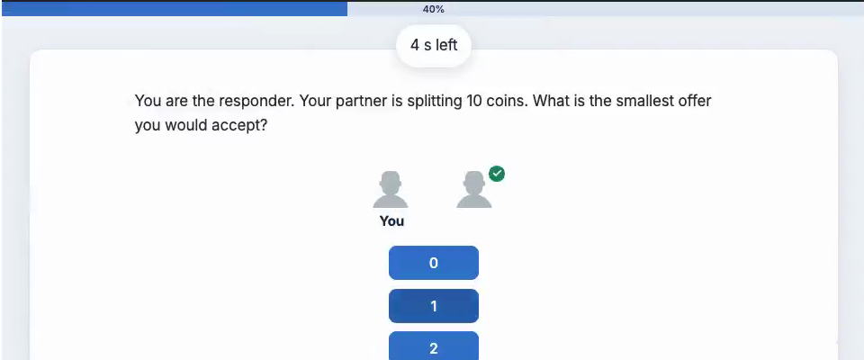
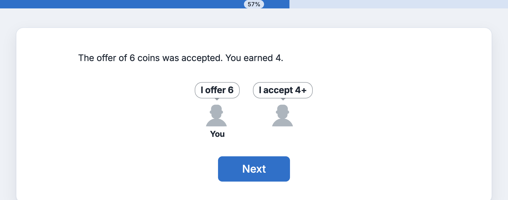
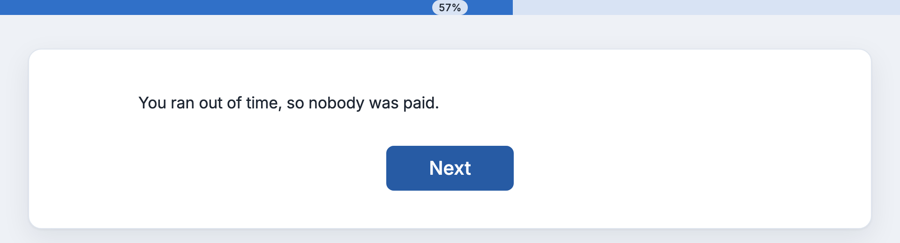
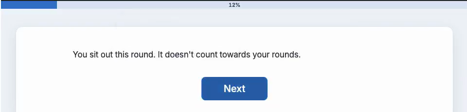

Writing a round-based experiment
================================

Many group experiments are games played over several rounds: players are
paired or grouped, decide, see the result, and are grouped again for the
next round. This page builds one such game step by step, the
``ultimatum_pairing`` demo, and then shows how other games vary it. Each
class and option links to its API reference where it first appears;
:doc:`synchronization` is the reference for everything else.

In the demo, cohorts of up to four players form as players arrive. Each round, the
cohort is split into pairs, and in each pair a proposer offers part of 10
coins while the responder says the smallest offer they would accept. A
player who is slow, closes their tab or sits a round out never holds up the
others, and nobody is failed for it. Each player's round is one trial, and
the two trials of a pair share a round record that holds the pair's results, so the
game's data can be read back from trials and rounds.

Forming cohorts
---------------

A :class:`~psynet.sync.SimpleGrouper` forms the cohorts. It starts a cohort
of four as soon as four players are waiting, or a smaller one after a
minute (``start_short_after``), and lets latecomers join a cohort that has
started (``join_existing_groups``; see :class:`~psynet.sync.SimpleGrouper`).
A latecomer is a pending member of the cohort until the next split admits
them (``admit_newcomers="at_admission_point"``; see
:ref:`sync-admission-points`), so nothing waits for them before that:

.. literalinclude:: ../../../demos/experiments/ultimatum_pairing/experiment.py
   :start-at: SimpleGrouper(
   :end-before: Module(
   :dedent: 8

A latecomer who joined after the first rounds would soon have nobody left
to play with, because the others finish their rounds and leave, so the
regrouper below closes each cohort to latecomers when its second round
starts (``stop_top_ups_after_rounds``). A latecomer still waiting for a
split then is turned away with removal reason ``"not_admitted"``.

Pairing players each round
--------------------------

A :class:`~psynet.sync.Regrouper` at the start of each round splits the
cohort into new pairs. Each time a player reaches it, they leave last round's
pair and wait for the next split. ``PairingRegrouper`` is the demo's own
subclass of :class:`~psynet.sync.Regrouper`, defined in its ``pairing.py``
(see :ref:`sync-regrouper-recipe`), which keeps last round's
partners apart and alternates roles:

.. literalinclude:: ../../../demos/experiments/ultimatum_pairing/experiment.py
   :start-at: pairing = PairingRegrouper(
   :end-before: OUTCOME_TEXTS

The round starts as soon as the whole cohort (``within``) is waiting, or at
the ``deadline`` (counted from when the first player is back) without whoever
isn't back yet, if enough players are waiting to
form a pair. A player who isn't back by then is still in the cohort, and
joins the next round. The demo's bot test starts such a round with
:func:`~psynet.bot.regroup_now`, so it doesn't wait for the deadline.
With ``roles``, each pair has a proposer and a responder; the demo's
regrouper gives each role to whoever has held it least often, so each
player alternates between them. ``stop_top_ups_after_rounds=OPEN_FOR_ROUNDS``
lets latecomers join the cohort only during its first round. Every split
that forms pairs in the cohort counts as one of its rounds, even one that
pairs only latecomers while the others are still playing, and the split
after that stops the cohort's top-ups. ``waiting_message`` counts down to
the deadline. See :class:`~psynet.sync.Regrouper` for these options:

The regrouper keeps the round's bookkeeping, so the game doesn't need to
store it in participant variables:

- ``pairing.rounds_played(participant)`` counts the pairs the player has
  joined, including one whose partner left or that they were removed from;
- ``pairing.rounds_sat_out(participant)`` counts the rounds they sat out.

Each player's role in the round is on their trial, as ``sync_group_role``
(below). :class:`~psynet.sync.Regrouper` lists its other methods, such as
``sat_out`` and ``role``.

.. _rounds-one-trial-per-player:

One trial per player per round
------------------------------

Each round of the timeline is the regrouper followed by one trial per player,
added with :meth:`Trial.cue() <psynet.trial.main.Trial.cue>`, without a trial
maker:

.. literalinclude:: ../../../demos/experiments/ultimatum_pairing/experiment.py
   :start-at: Module(
   :end-before: leave_group(COHORT)
   :dedent: 8

The trial class sets ``sync_group_type``, so the trials that a pair's
members cue in a round share one :class:`~psynet.sync.SyncGroupRound`
(``trial.group_round``).
Each trial records the pair (``sync_group_id``), the player's role
(``sync_group_role``), the pair's round (``sync_group_round``) and how the
round ended for the player (``sync_group_outcome``, see
:ref:`rounds-explaining-the-outcome`), and keeps
them after the pair ends. The ``Module`` gives the rounds a ``module_id`` to
find them by when exporting.

``cue`` numbers each group's rounds from 0, so every pair here, new each
round, plays round 0, and a definition must not depend on the player's own
position in the loop. :ref:`rounds-cued-trials` explains when a cue joins a
round, a trial's two round counters (``sync_group_round`` and
``position``), a fixed group's loop with ``round=``, and several trial
classes in one round.

The ``switch`` decides once, before the trial: a player in a pair gets
the trial, one who sat out gets a page instead (see
:ref:`rounds-sitting-out`), and one whose cohort has gone moves on to the
page saying the game ended early:

.. literalinclude:: ../../../demos/experiments/ultimatum_pairing/experiment.py
   :pyobject: round_status

Once started, the trial runs to its end, where
it is scored, even if the player is removed from their pair partway, so
its feedback covers every outcome of the round. A round that is one cued
trial needs no more than this; ``join(..., stop_if=...)`` is for rounds of
several steps.

The trial's ``show_trial`` is the decision page followed by a
:class:`~psynet.sync.GroupBarrier` for the pair:

.. literalinclude:: ../../../demos/experiments/ultimatum_pairing/experiment.py
   :pyobject: OfferTrial.show_trial

Making a decision
-----------------

The decision page reads the player's role from the trial, and its
:class:`~psynet.group_prompt.GroupPrompt` shows the pair. The partner gets
a tick as soon as they have decided. Players normally appear as their
:doc:`pseudonym's <pseudonyms>` animal, which stays the same from
round to round. ``names="anonymous"`` draws both players as the same grey figure
instead, so that nobody recognises a partner from an earlier round:

.. literalinclude:: ../../../demos/experiments/ultimatum_pairing/experiment.py
   :pyobject: OfferTrial.decision_page

The page's ``time_limit`` gives each player 30 seconds. A player who
doesn't answer in time moves on with no answer (``time_limit_answer``,
``None`` by default), and their partner sees a grey dash instead of a
tick.

.. _rounds-slow-players:

Moving slow players on
----------------------

The barrier after the decision page waits for
both partners. A player who hasn't reached it within ``late_after`` seconds
of the round's start is late. A late player has usually closed their page,
so with ``late_action="leave_group"`` and ``also_leave=[COHORT]`` they are
removed from the pair and from the cohort: their partner carries on alone,
and the next split doesn't wait for them. Without ``also_leave`` they leave
the pair only, so the next split would wait for them until its deadline
(see :class:`~psynet.sync.GroupBarrier` and :ref:`sync-leaving-a-group`).
A player on a page
with a time limit is not late before that limit has run out and an answer
sent at the deadline has had 10 seconds to arrive, so the late limit need
not be longer than the page's time limit.
For example, with a 30-second decision page and
``late_after=30``:

- A player who answers after 12 seconds waits at the barrier for their
  partner.
- A partner who leaves the page open without answering moves on at 30
  seconds, when the time limit runs out. The pair continues together, and
  nobody is paid.
- A partner who closes their tab partway through the page is removed from
  the pair about 40 seconds into the round: 10 seconds after the page's time
  limit.
- A partner whose tab never opened the page is removed from the pair 30
  seconds after the round started.

30 seconds is long enough for a tab in the background to notice that a
round has started. ``late_after`` counts from the previous barrier, so pages
without a time limit before the decision page, such as the last round's
results, count towards it: give them a time limit too, or make
``late_after`` long enough for a slow reader. A player who was removed from the pair sees "Your
partner went on without you. Please continue." on the progress bar (pass
``on_arrival_message`` to the barrier to change it).

The barrier checks for late players only while their partner waits at it,
so if neither partner comes back, the next split waits for its deadline. A
late player who comes back is told that they were away, and their game ends.

Once the cohort has stopped top-ups, removing a late player dissolves it if
that leaves it below its quorum (see :ref:`groups_below_quorum`).
``below_quorum="fail"`` would then fail the players who were on time while
the late player carries on, which the experiment rejects when it loads, so
the cohort's grouper sets ``below_quorum="continue_without_group"``, and
they carry on without the cohort, which ends their game.

A player removed from their pair finishes the trial: its later group
barriers let them straight through, and its feedback tells them they were
away, because their trial's ``sync_group_outcome`` is ``"late"``.

Scoring the round
-----------------

The barrier's ``on_release`` scores the pair once both have arrived, or once
the one who is left has. It takes ``trials``, the members' trials, and
``group_round``, the round they share, so a ``@classmethod`` on the trial class can
save the pair's players, offer and result in ``group_round.var`` and each player's coins on
their trial, where a page reloaded later still finds them. When a partner
left or ran out of time, nobody is paid. The ``left`` argument lists the
members who left the pair this round, and
``sync_group_removal_reason`` tells a partner who was too slow apart from
one who returned the study. ``trials`` only holds the trials of members
still in the pair, so the players of the round come from ``group_round.trials``,
which also keeps the trial of a player removed for being away:

.. literalinclude:: ../../../demos/experiments/ultimatum_pairing/experiment.py
   :pyobject: OfferTrial.score_pair

The barrier is inside ``show_trial``, so the trials have not ended yet when
``on_release`` runs: ``trial.answer`` holds each member's answer so far,
which here is their decision, or ``None`` if their page ran out of time.

.. _rounds-explaining-the-outcome:

Explaining the outcome
----------------------

The trial ends after the barrier, so its feedback can read what was stored
during the round rather than work it out from the player's groups:

- ``self.sync_group_outcome`` says how the round ended for this player:
  ``"stayed"`` once the barrier released the pair with them in it, or why
  they left the pair before then, here ``"late"`` for a player taken out for
  being away (see :ref:`round outcomes <sync-round-outcome>` for every value);
- ``self.answer`` is their own decision, ``None`` if they ran out of time;
- ``self.group_round.var`` holds what ``on_release`` saved for the pair.

A partner's outcome is on their trial in ``self.group_round.trials``.
``outcome`` turns these into one key of ``OUTCOME_TEXTS``:

.. literalinclude:: ../../../demos/experiments/ultimatum_pairing/experiment.py
   :pyobject: OfferTrial.outcome

``show_feedback`` shows that text, and when the pair made a deal, passes
both answers to the prompt as speech bubbles:

.. literalinclude:: ../../../demos/experiments/ultimatum_pairing/experiment.py
   :pyobject: OfferTrial.show_feedback

   A player whose time ran out.

To pay a bonus as well, return a score from ``score_answer`` and the bonus
from ``compute_performance_reward``, as the ``public_goods`` demo
does; both run when the trial ends, after ``on_release``. For example, to
pay each player's coins and an extra bonus to the round's winner, mark the
winner where ``on_release`` scores the round:

.. code-block:: python

    COIN_VALUE = 0.01
    WINNER_BONUS = 0.05

    class OfferTrial(Trial):
        @classmethod
        def score_pair(cls, trials, group_round, left):
            ...  # Save each player's coins on their trial, as above.
            best = max(trial.var.coins for trial in trials)
            for trial in trials:
                # Ties all win; nobody wins a round in which nobody was paid.
                trial.var.won = best > 0 and trial.var.coins == best

        def score_answer(self, answer, definition):
            return self.var.get("coins", 0)

        def compute_performance_reward(self, score):
            bonus = WINNER_BONUS if self.var.get("won") else 0
            return COIN_VALUE * score + bonus

``var.get`` covers a trial whose round was not scored, such as that of a
player who left before the barrier.

.. _rounds-sitting-out:

Sitting out
-----------

With three players in a cohort, one of them has no partner. The player who has
played the most rounds sits the round out; with ``left_over="sit_out"``
they move on without a pair instead of waiting (see
:class:`~psynet.sync.Regrouper`), so the ``switch`` gives them a page
instead of a trial that round. A player who was paired but removed from the
pair before submitting their decision has a trial, and the first checks in
``outcome`` above tell them that they were away or were removed from the
pair.

Ending the game
---------------

The rounds loop runs while ``game_over_reason`` returns ``None``. The
function names each way a player's game can end: they played their rounds,
sat out too often, were removed for being late or by the experimenter on the
dashboard, or their cohort is down to one player. (A player removed from just
their pair is told so on that round's results page.)

.. literalinclude:: ../../../demos/experiments/ultimatum_pairing/experiment.py
   :pyobject: game_over_reason

Players who finish leave the cohort with
:func:`leave_group(COHORT) <psynet.sync.leave_group>`, so that the
regrouper doesn't wait for them in later rounds. It removes them with
``reason="finished"``, which doesn't dissolve the closed cohort by itself,
so players who finish first don't end the round of those still playing.
The cohort's next barrier, here the regrouper's next split, can still
dissolve it if it is below its quorum then (see
:ref:`groups_below_quorum`).

After that, a ``switch`` on ``game_over_reason`` shows a page for each early
end that still needs explaining. A player removed for being late has
already been told on their round's results page, so they get none.

Exporting the rounds
--------------------

The results stay on the trials and rounds, so ``get_basic_data`` builds a
table with one row per player and round from the trials, including each
player's ``sync_group_outcome``, and one with a row per pair from the rounds.
Rounds a player sat out have no trial, so a third table counts them with the
regrouper (see :doc:`/data/basic_data`):

.. literalinclude:: ../../../demos/experiments/ultimatum_pairing/experiment.py
   :pyobject: Exp.get_basic_data

.. _rounds-variations:

Variations
----------

**New groups from everyone waiting.** Without ``within``, a regrouper
splits everyone waiting, not one cohort, so how many play together depends
on how busy the experiment is. With ``every=10`` it splits them every 10
seconds into groups of up to ``group_size``. Each group is new, so its
trials are all in round 0, and a group can mix players at different rounds
of the game; number each player's own trials as their round in the export
(``trial.position``). Pass ``max_wait_action="continue_without_group"``
and follow the regrouper with a :func:`~psynet.timeline.conditional` on
``participant.in_sync_group(...)``, so that a player left with nobody to
play with, such as a latecomer whose last round comes after everyone else
has finished, carries on without a group instead of being failed:

.. code-block:: python

    for_loop(
        label="rounds",
        iterate_over=range(N_ROUNDS),
        logic=join(
            Regrouper(
                "room",
                group_size=8,
                smallest_group=2,
                every=10,
                waiting_message=round_message,
                max_wait_time=60,
                max_wait_action="continue_without_group",
            ),
            conditional(
                "in_room",
                lambda participant: participant.in_sync_group("room"),
                PickTrial.cue({"numbers": [1, 2, 3, 4, 5]}),
                InfoPage("Nobody else was left to play this round with.", time_estimate=5),
            ),
        ),
        time_estimate_per_iteration=PickTrial.time_estimate + 5,
    )

**A draw per group.** ``definition`` can also be a function, for example
``lambda group: {"target": random.choice(TARGETS)}``. It is called once per
group and round, when the first member's cue creates the round, so the
whole group plays the same draw. A player who is in no group of that type
when the trial starts gets an ungrouped trial if the trial class sets
``sync_group_optional = True``, with ``sync_group_id`` set to ``None``
(otherwise the cue raises an error); ``show_trial`` can check
``self.sync_group is None`` to give them a solo version. The ``crowd_estimate`` demo does this in a fixed group's
loop of questions, cued with ``round=question``, and exports each round's
``sync_group_outcome`` for each player.

**A fixed team that plays on with dropouts.** The ``public_goods`` demo
forms teams of three once, with a :class:`~psynet.sync.SimpleGrouper` and
``quorum=2``, and plays its rounds as a loop of cued trials with the loop
value as ``round=`` (see :ref:`a fixed group's loop <rounds-fixed-group-loop>`). Its barrier
removes a late player with ``late_action="leave_group"``, the others share
the pot between fewer players, and ``score_answer`` pays each player by
their trial's ``sync_group_outcome`` (see
:ref:`round outcomes <sync-round-outcome>`), including the last player of
a team that dissolves.

**Turns one after the other.** In games such as a trust game, the investor
decides before the trustee. With cued trials, the role pages and the
barriers between turns all go in the ``show_trial`` of one trial class. Put
each role's page in a
:func:`~psynet.timeline.conditional` on the role, followed by a
:class:`~psynet.sync.GroupBarrier` for the pair: the other player waits at
the barrier while it is not their turn. A ``waiting_screen`` on the barrier
tells them whose turn it is; a :class:`~psynet.group_prompt.GroupPrompt` with
``show_progress=False`` shows the pair there without the waiting
player's own tick. In bot tests, ``advance_past_wait_pages(bots,
stop_at="investor_sent")`` leaves the bots waiting at that barrier, so the
test can take the investor's turn first. Once the investor's answer releases
the barrier, the same call moves the trustee on: ``stop_at`` holds only bots
the barrier hasn't released yet. The first turn's barrier closes the round
to newcomers: a player who joins the pair after it starts the next round
rather than joining a round whose first turn is over.

**Turns in a fixed group.** In the ``story_chain`` demo, a group of three
writes a story one sentence at a time. Each turn is one cued round in the
group's loop, ``StoryTurn.cue(turn_definition, round=turn)`` (see
:ref:`a fixed group's loop <rounds-fixed-group-loop>`). The definition
function runs only at the turn's first cue, so it chooses the writer once,
by seat with :func:`~psynet.sync.group_seats`, and the round's definition
stores their ID for every member's trial and for the export:

.. literalinclude:: ../../../demos/experiments/story_chain/experiment.py
   :pyobject: choose_writer

The writer gets the writing page and then a code block that stores their
sentence in ``group_round.var``, before the turn's barrier; the others go straight
to the barrier, whose ``waiting_screen`` shows them the story so far. The
barrier closes the round:

.. literalinclude:: ../../../demos/experiments/story_chain/experiment.py
   :pyobject: StoryTurn.show_trial

The sentence is stored in the writer's own request, so it is there before
the barrier lets the others go on, and it is kept if the group dissolves
while the writer is still writing. A writer the barrier has already removed
for being late stores nothing. The barrier never removes a member while
their own request is in progress, so the check needs no lock:

.. literalinclude:: ../../../demos/experiments/story_chain/experiment.py
   :pyobject: StoryTurn.save_sentence

A turn can also end without a sentence, when the writer is late or leaves.
Each member's trial stores ``None`` when it finishes if the turn has no
sentence yet, so every finished turn has one, whether the barrier released
or the group dissolved:

.. literalinclude:: ../../../demos/experiments/story_chain/experiment.py
   :pyobject: StoryTurn.on_finalized

When the sentence is ``None``, the writer trial's
``sync_group_outcome`` says why: ``"stayed"`` if they ran out of time, or
why they left the group, such as ``"late"`` if the barrier took them out or
``"left_experiment"`` if they returned the study. With
``"group_dissolved"``, the writer was the last one left and ran out of time
or returned the study. If the
chosen writer leaves between the turn's first cue and their own, they have
no trial for the turn at all, and the export's ``writer_outcome`` is
``None``. The export has one row per turn, from the rounds and the writers'
trials, and its ``finished`` column tells a turn that stored ``None`` from
one that never finished. Each member stores their group's ID when the
group forms, so the last page can read the story with
:meth:`SyncGroup.rounds("story") <psynet.sync.SyncGroup.rounds>` even after
the group has ended.

**Your own grouping.** ``form_groups`` replaces the default grouping, for
example to pair players by their earlier answers, and ``assign_roles``
replaces the default random roles. The demo's regrouper overrides both, to
keep last round's partners apart and to alternate roles (see
:ref:`sync-regrouper-recipe`). With roles, each group needs
one member per role. See
:class:`~psynet.sync.Regrouper` for this and the other settings.

**A trial maker.** A trial maker with ``sync_group_type``, as in the
``create_rate_sync`` demo, gives a group's members their trials
together and numbers the group's rounds from 0 in ``sync_group_round``.
Cued trials suit games whose groups change every round, or whose rounds are
a plain loop in the timeline.
