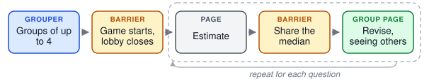
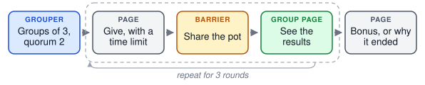

.. _concept_groups:

Groups
======

In a **group experiment**, several participants take part at the same time and
interact: they play a game against each other, rate the same stimuli together,
or talk in a chatroom. The rest of the :doc:`timeline <timeline>` stays the
same; groups add points where participants wait for each other.

Forming groups
--------------

A **grouper** in the timeline collects participants as they arrive and forms
a group once enough are waiting, for example two for a two-player game.
Participants wait on the page they are on until their group is complete. A
grouper can also wait for a larger batch and then split it into groups; the
built-in grouper splits it at random, and a custom grouper can choose the
split, for example to balance groups. Waiting for a larger batch gives the
grouper more choice but makes participants wait longer, so a grouper can also
start a smaller group once its first participant has waited long enough.

Groups are formed from whoever is online at the same moment, so recruitment
has to bring participants in close together. A participant who waits too long
without a group is failed and sent to the end of the experiment, unless you
choose to let them continue without one, for example with a task of their own.

Keeping a group in step
-----------------------

A **barrier** makes every member of a group wait until all members have
reached it. Barriers go wherever the design needs participants to be in the
same place: before a round starts, after everyone has responded, or before
results are shown. When the last member arrives, the barrier can run code for
the whole group, such as scoring a round or assigning roles. For rounds of
cued trials, where a barrier's release also closes the round, see
:ref:`rounds-cued-trials`.

In a trial maker, the group can also share its trials. One member acts as the
**leader**: PsyNet picks the leader's next node as if they were taking the
trial maker alone, and the other members get trials on the same node, so
everyone sees the same stimulus in each round.

Waiting and dropouts
--------------------

Participants leave groups in several ways, and PsyNet learns of each in a
different way:

.. list-table::
   :header-rows: 1
   :widths: 28 36 36

   * - The participant…
     - When PsyNet acts
     - What you decide
   * - returns the study on the recruitment platform, or is failed by the
       experiment, for example for a failed check
     - At once: they are failed and leave their group.
     - Whether the others carry on without them.
   * - closes the tab or stops responding
     - Only when a time limit runs out. Either they are **late**: they
       haven't reached the next barrier within a set number of seconds. Or
       the members waiting for them at a barrier reach its **maximum waiting
       time**.
     - Whether the late member, or the members who waited, are failed or
       continue the experiment without the group.
   * - comes back after being removed from the group
     - A notice tells them what happened, and they continue the experiment
       without the group.
     - What they do for the rest of the experiment: a task on their own, an
       early end, or a new group.
   * - arrives when no group can form
     - When they have waited at the grouper for its maximum waiting time:
       they are failed, or continue without a group.
     - Whether a smaller group may start instead, whether they may join a
       group that has lost a member, and whether those left over are failed
       or continue on their own.

A member on a page with its own time limit is not late before the page's time
limit has run out. By default, participants are credited for the actual time
they wait, up to the maximum.

When someone leaves, a group that still has its **quorum**, the smallest
size at which it can go on, carries on. Below it, the group either waits
for a newcomer or is dissolved, and the grouper's ``below_quorum`` decides
for those left: with ``below_quorum="fail"`` they are failed too, and with
``below_quorum="continue_without_group"`` they continue the experiment
without the group (see :ref:`groups_below_min_size`). Decide this for every
grouper; PsyNet requires it for groups designed to shrink, such as those
with a quorum below their size or whose barriers remove late members. Failed
participants are paid for what they completed (see
:doc:`/code/participants/payment`).

Plan for dropouts: decide whether a round can continue with fewer members,
whether the remaining members should go on alone or finish early, and how
their data will be analyzed.

Groups can go through the experiment in two ways, **cued trials** or a
**synchronized trial maker**:

.. list-table::
   :header-rows: 1
   :widths: 34 40 26

   * - The design
     - Use
     - Demos
   * - A game played in rounds without a stimulus set, such as an economic
       game, with the same group or new partners every round
     - **Cued trials**: a loop in the timeline with one
       :meth:`Trial.cue() <psynet.trial.main.Trial.cue>` per player in each
       round, after a regrouper when partners change (see
       `New groups for each round`_). The trials of a group's round share a
       node that holds the group's results.
     - ``public_goods``, ``ultimatum_pairing``, ``story_chain``
   * - A group working through a stimulus set or a chain together, each
       member getting a trial on the same stimulus
     - **A synchronized trial maker**: a trial maker with a group type
       (``sync_group_type``), which gives the members trials on the same
       nodes and keeps them in step from trial to trial.
     - ``create_rate_sync``, ``gibbs_within_sync``

Either way, each trial records the group, the player's role and the round,
so the data can be analyzed round by round. Only cued trials record how the
round ended for each player (``trial.sync_group_outcome``) and can be read
back round by round with
:meth:`SyncGroup.rounds() <psynet.sync.SyncGroup.rounds>`; a synchronized
trial maker's trials have neither, so read them from the trial table.

Talking to each other
---------------------

A **chatroom** lets group members exchange messages on a page. Messages are
stored with the experiment's data, so conversations can be analyzed later.

Other **real-time interaction**, such as taking turns in a game on one page,
works the same way: each member's page sends actions to the server as they
happen. The server is the authority on the shared state. It accepts or rejects
each action, for example one made out of turn, and sends the result to every
member, whose page shows only what the server sent. Decide what each member
is allowed to see, what happens when a member's connection drops or they
reload the page, and which parts of the interaction are recorded for
analysis.

In ``demos/features/websocket_chatroom``, each participant chooses a room and
then chats with whoever else is in it; messages are sent live, without
reloading the page.

.. figure:: ../_static/images/design/groups/websocket_chatroom.svg
   :alt: A page to choose a room, then a group page that sends messages live
      to the room.

Seeing who you're playing with
------------------------------

Group members see each other by a **pseudonym**, such as "Pink koala", drawn
as an animal in a colour, never by their real identity:

.. figure:: ../_static/images/design/groups/pseudonyms_chat.png
   :width: 520
   :alt: A chatroom in which the participant is labelled "You" and their
      partner "Pink koala", each with their animal next to their messages.

A participant keeps the same pseudonym for the whole experiment, so when
groups change from round to round, players can recognise someone they met
before. If that could change how they behave, for example because a player
could build a reputation in a game, show members **anonymously** instead:
everyone appears as the same grey figure.

.. figure:: ../_static/images/design/groups/anonymous_partner.png
   :width: 520
   :alt: A decision page that shows the participant and their partner as two
      identical grey figures, one labelled "You".

The dashboard shows each participant's pseudonym, and the names that
participants saw can be recovered from an export, for example to read chat
messages that mention them (see :doc:`/code/multiplayer/pseudonyms`).

Kinds of group experiment
-------------------------

Most group experiments are one of these kinds, or combine several. Each kind
has a demo to start from.

- **One group does a task together**, such as a discussion, repeated rounds
  of a game with the same partner, or creating and rating answers:
  `chatroom_simple <https://gitlab.com/PsyNetDev/PsyNet/-/tree/master/demos/experiments/chatroom_simple>`__,
  `rock_paper_scissors <https://gitlab.com/PsyNetDev/PsyNet/-/tree/master/demos/experiments/rock_paper_scissors>`__
  and `create_rate_sync <https://gitlab.com/PsyNetDev/PsyNet/-/tree/master/demos/experiments/create_rate_sync>`__.
- **Members take turns**, each waiting while another acts:
  `story_chain <https://gitlab.com/PsyNetDev/PsyNet/-/tree/master/demos/experiments/story_chain>`__.
- **A group shares a chain of stimuli**, each member rating the same one:
  `gibbs_within_sync <https://gitlab.com/PsyNetDev/PsyNet/-/tree/master/demos/experiments/gibbs_within_sync>`__.
- **An open lobby that latecomers can join**, with groups that start short
  and fill up until their game starts:
  `crowd_estimate <https://gitlab.com/PsyNetDev/PsyNet/-/tree/master/demos/experiments/crowd_estimate>`__.
- **Part of the experiment needs enough people present**, with other work
  until then:
  `sync_quorum <https://gitlab.com/PsyNetDev/PsyNet/-/tree/master/demos/experiments/sync_quorum>`__.
- **Players get new partners every round**, within a cohort that stays
  together:
  `ultimatum_pairing <https://gitlab.com/PsyNetDev/PsyNet/-/tree/master/demos/experiments/ultimatum_pairing>`__.
- **A team game carries on when members leave**, with fewer players, until
  too few remain:
  `public_goods <https://gitlab.com/PsyNetDev/PsyNet/-/tree/master/demos/experiments/public_goods>`__.
- **Members interact live**, with messages sent to everyone as they are
  written:
  `websocket_chatroom <https://gitlab.com/PsyNetDev/PsyNet/-/tree/master/demos/features/websocket_chatroom>`__.

:doc:`/demos/index` lists every demo.

From one group to many rounds
-----------------------------

The demos below show group designs in order of complexity. Each diagram shows
a demo's timeline as a sequence of blocks; a dashed box repeats.

One group for the whole experiment
^^^^^^^^^^^^^^^^^^^^^^^^^^^^^^^^^^

The simplest design forms a group once and keeps it to the end, with barriers
wherever the members must be in step.

In ``demos/experiments/chatroom_simple``, pairs discuss a topic in a chatroom.
The trial maker starts both partners on the chat together, and a barrier after
the chat waits until both have finished before either moves on.

.. figure:: ../_static/images/design/groups/chatroom_simple.svg
   :alt: A grouper forms pairs, both chat on a group page, and a barrier waits until both have finished.

In ``demos/experiments/rock_paper_scissors``, the same pair plays three rounds.
Each player chooses within a time limit, a barrier scores the round, and both
see the result. Rounds don't need new groups when partners stay the same.

.. figure:: ../_static/images/design/groups/rock_paper_scissors.svg
   :alt: A grouper forms pairs. Then, for three rounds, players choose with a time limit, a barrier scores the round, and both see the result and can chat.

In ``demos/experiments/create_rate_sync``, each member of a group of three
writes an answer, then rates the others' answers, and the group sees which
answer won. One barrier waits until all answers are in, and another counts the
votes.

.. figure:: ../_static/images/design/groups/create_rate_sync.svg
   :alt: A grouper forms groups of three. Then, for each trial, members create an answer, wait at a barrier, rate the others' answers, wait at a barrier that counts the votes, and see the results.

In ``demos/experiments/story_chain``, a group of three writes a story one
sentence at a time, taking turns in seat order. While one member writes, the
others wait at a barrier that shows them the story so far. The writer's
sentence is stored on the turn as soon as they submit it. A writer who runs
out of time adds nothing that turn; a member who leaves plays no more turns,
and the next member in seat order writes in their place. The last one left
goes on to the story so far.

In ``demos/experiments/gibbs_within_sync``, a group of three shares a chain of
stimuli. The leader's next stimulus is chosen as if they were taking the
experiment alone, and everyone rates that same stimulus. Newcomers can join a
group that has lost members.

.. figure:: ../_static/images/design/groups/gibbs_within_sync.svg
   :alt: A grouper forms groups of three, then for each trial every member rates the leader's stimulus.

In ``demos/experiments/sync_quorum``, everyone joins one growing group, and
part of the experiment only opens while at least three members are present.
Until then, and whenever the group drops below three, members do filler
trials instead of waiting.

.. figure:: ../_static/images/design/groups/sync_quorum.svg
   :alt: A grouper waits for three participants while they do filler trials. Then, three times, a member sees the quorum page if enough members are present, or a filler trial otherwise.

Groups that latecomers can join
^^^^^^^^^^^^^^^^^^^^^^^^^^^^^^^

Waiting for a full group makes the first arrivals wait longest, and a group
that loses a member early may still be worth saving. An **open lobby** lets
a group **start short**, with fewer members than it would like, once its
first member has waited long enough, and then **tops it up**: latecomers join
a group that has a free place instead of waiting for a new one. Top-ups
can stop when the game starts, so that every member plays every round;
from then on, latecomers wait for a new group. Alternatively, a group can
keep taking latecomers during the game, who wait to be admitted at the
start of the next round, an **admission point** (see
:ref:`sync-admission-points`). A group
that falls below its quorum before the game starts can wait a little while
for a latecomer to replace the member who left (see
:ref:`groups_below_min_size` for when a group ends).

In ``demos/experiments/crowd_estimate``, groups of up to four play a
wisdom-of-crowds game; a group of three may start after a short wait. For
each of two questions, every member estimates the answer, a barrier shares
the group's median, and members see everyone's estimate and may revise their
own. A group needs three members, because the median of two estimates is
just their mean, so the group's quorum is three. Nobody is failed for
waiting or for what another player did: a participant who finds no group,
whose group ends, or who was removed for being late answers the remaining
questions alone.

age that shows everyone's estimate.

New groups for each round
^^^^^^^^^^^^^^^^^^^^^^^^^

Some designs give players new partners in each round, for example so that
each player meets several others. ``demos/experiments/simple_sync_group``
does this once by hand: a **group closer**, a barrier that ends the group
once all its members reach it, closes the first groups, and a second grouper
forms new pairs.

.. figure:: ../_static/images/design/groups/simple_sync_group.svg
   :alt: A grouper forms groups of three and members see their group. A barrier closes the group, then a second grouper forms new pairs and members see their pair.

Repeating this every round would make each player wait for their whole old
group before they could be regrouped, and fail the group's members when one of
them drops out. A **regrouper** is made for this instead. Each time
participants reach it, it removes them from their previous group and splits
those waiting into new groups at random and gives out roles such as
proposer and responder at random. If the
players don't divide evenly into groups, the player who has played the most
rounds **sits out** the round; they see a page saying so and play again in a
later round. A player who is late for a split joins the next one. If no
further split comes within the regrouper's maximum waiting time, for example
after the last round, they are failed by default
(``max_wait_action="fail"``), unless the regrouper lets them continue
without a group (``max_wait_action="continue_without_group"``).

A regrouper doesn't split players as soon as two are waiting, because that
would pair whoever finished at the same moment, often the same people every
round. It collects players first and splits them at a deadline, for example
every 10 seconds (``every=10``).

Cohorts that regroup each round
^^^^^^^^^^^^^^^^^^^^^^^^^^^^^^^

When everyone waiting is split together, what a player experiences depends
on how busy the experiment is: at a busy moment a group has eight players, at
a quiet one two. To keep this the same for everyone, a grouper first forms
**cohorts**, groups that stay together for the whole game (called *matching
groups* in experimental economics). The regrouper then splits each cohort
into new groups every round, so players only ever meet others in their cohort.
Because the regrouper knows who is in the cohort, a round can start as soon as
the whole cohort is back; the deadline only matters when someone is missing.

In ``demos/experiments/ultimatum_pairing``, a grouper forms cohorts of four,
or of two or three once the first player has waited a minute. Each round, the
regrouper splits the cohort into pairs of a proposer and a responder. The
proposer offers part of 10 coins, and the responder accepts or rejects the
offer.

.. figure:: ../_static/images/design/groups/ultimatum_pairing.svg
   :alt: A grouper forms cohorts of four. Then, for each round, a regrouper splits the cohort into pairs, players decide with a time limit, a barrier waits for the partner, and both see the outcome.

Slow players and the end of a game
^^^^^^^^^^^^^^^^^^^^^^^^^^^^^^^^^^

Rounds need a plan for slow players, because a player who stops responding
holds up their partners. Give decision pages a time limit. A player who runs
out of time moves on, and their partners see that they ran out of time instead
of waiting. A player who falls further behind, for example because they closed
the tab, is late at the barrier after the decision: they are removed from
the group, and either rejoin in the next round or, as in
``ultimatum_pairing``, end their game.

Decide when the game ends: after a fixed number of rounds, when a player has
sat out too often, or when too few players remain to form a group.

In ``demos/experiments/public_goods``, a group of three plays three rounds.
Each round, every player privately puts some of their tokens in a shared pot,
within a time limit; the pot grows by half and is shared between the players
of that round, who then see everyone's contributions and what they earned,
paid as a bonus. A player who runs out of time puts nothing in, but keeps
their tokens and their share. A player who returns the study or stops
responding leaves the group and earns nothing for that round, and the other
two carry on and share the pot between them. When only one player is left, the
game ends: that round is cancelled and they keep their tokens for it. Nobody is failed because others left;
the last player, a player who comes back after being removed, and a
participant for whom no group formed each see why the game ended for them.
Each round is one trial per player that pays that round's bonus, so the data
and the payments agree.

What to check when reviewing group experiments
----------------------------------------------

- Is recruitment fast enough to form groups? Waiting participants cost money
  and may leave.
- Is there a barrier everywhere members must be in step, and nowhere else?
- What happens to each remaining member when someone drops out mid-round?
- Are maximum waiting times long enough for the slowest pages, and short
  enough that participants don't give up?
- In a game played in rounds, what do a player's partners see when the
  player runs out of time?
- Is sitting out fair, and do rounds a player sits out count towards their
  total?
- In a real-time interaction, can a member see information meant only for
  others, and can the interaction resume after a reload?
- Can players recognise each other across rounds, and should they?

.. seealso::

   :doc:`/code/multiplayer/writing_a_round_based_experiment` shows how these
   ideas appear in ``experiment.py``, using the
   ``demos/experiments/ultimatum_pairing`` demo.

   The :doc:`/skills/synchronous-experiments` skill describes how to design
   and test group experiments.

