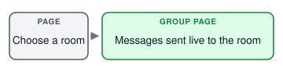
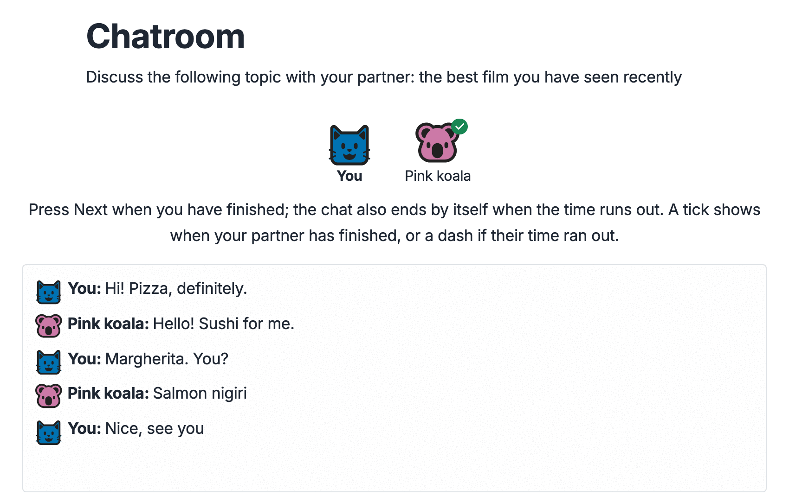
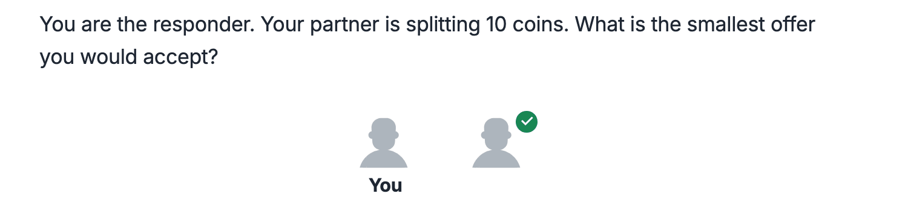
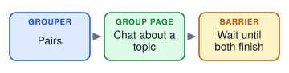
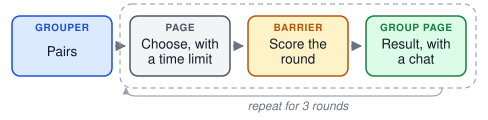
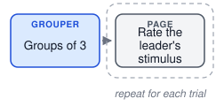
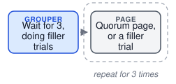
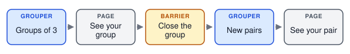
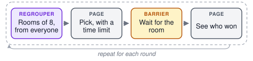
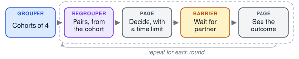

.. _concept_groups:

Groups
======

In a **group experiment**, several participants take part at the same time and
interact: they play a game against each other, rate the same stimuli together,
or talk in a chatroom. The rest of the :doc:`timeline <timeline>` stays the
same; groups add points where participants wait for each other.

Forming groups
--------------

A **grouper** in the timeline collects participants as they arrive and forms
a group once enough are waiting, for example two for a two-player game.
Participants wait on the page they are on until their group is complete. A
grouper can also wait for a larger batch and then split it into groups; the
built-in grouper splits it at random, and a custom grouper can choose the
split, for example to balance groups. Waiting for a larger batch gives the
grouper more choice but makes participants wait longer, so a grouper can also
start a smaller group once its first participant has waited long enough.

Groups are formed from whoever is online at the same moment, so recruitment
has to bring participants in close together. A participant who waits too long
without a group is failed and sent to the end of the experiment.

Keeping a group in step
-----------------------

A **barrier** makes every member of a group wait until all members have
reached it. Barriers go wherever the design needs participants to be in the
same place: before a round starts, after everyone has responded, or before
results are shown. When the last member arrives, the barrier can run code for
the whole group, such as scoring a round or assigning roles.

In a trial maker, the group can also share its trials. One member acts as the
**leader**: PsyNet picks the leader's next node as if they were taking the
trial maker alone, and the other members get trials on the same node, so
everyone sees the same stimulus in each round.

Waiting and dropouts
--------------------

Every barrier and grouper has a **maximum waiting time**. A participant who
waits longer, for example because a partner closed the browser, is released.
At a grouper they are failed; at a barrier, depending on its settings, they
are either failed or removed from the group, continuing the experiment without it.
A barrier can also catch members who fall behind: a member who hasn't
reached the barrier within a set number of seconds is **late**, and is
failed or removed from the group. A member on a page with its own time
limit is not late before the page's time limit has run out. By default,
participants are credited for the actual time they wait, up to the maximum.

By default, when a member is failed or leaves the experiment, a group that
falls below its quorum is dissolved, and its remaining members are
failed too. Decide this for every grouper (a regrouper's groups are never
dissolved): let the others continue with
fewer members (``fail_participants_below_quorum=False``), or have the
group wait for a newcomer to replace the one who left
(``join_existing_groups=True``). Failed participants are paid for what they
completed (see :doc:`/code/participants/payment`).

Plan for dropouts: decide whether a round can continue with fewer members,
whether the remaining members should go on alone or finish early, and how
their data will be analyzed.

Groups can go through the experiment in two ways. A **trial maker** with a
group type gives a group's members trials on the same stimuli, or nodes,
and keeps them in step from trial to trial; use it when a group works
through stimuli together. A **loop** with a regrouper and barriers (see
`New groups for each round`_) suits games without stimuli, and designs
where partners change from round to round.

Talking to each other
---------------------

A **chatroom** lets group members exchange messages on a page. Messages are
stored with the experiment's data, so conversations can be analyzed later.

Other **real-time interaction**, such as taking turns in a game on one page,
works the same way: each member's page sends actions to the server as they
happen. The server is the authority on the shared state. It accepts or rejects
each action, for example one made out of turn, and sends the result to every
member, whose page shows only what the server sent. Decide what each member
is allowed to see, what happens when a member's connection drops or they
reload the page, and which parts of the interaction are recorded for
analysis.

In ``demos/features/websocket_chatroom``, each participant chooses a room and
then chats with whoever else is in it; messages are sent live, without
reloading the page.

      to the room.

Seeing who you're playing with
------------------------------

Group members see each other by a **pseudonym**, such as "Pink koala", drawn
as an animal in a colour, never by their real identity:

      partner "Pink koala", each with their animal next to their messages.

A participant keeps the same pseudonym for the whole experiment, so when
groups change from round to round, players can recognise someone they met
before. If that could change how they behave, for example because a player
could build a reputation in a game, show members **anonymously** instead:
everyone appears as the same grey figure.

      identical grey figures, one labelled "You".

The dashboard shows each participant's pseudonym, and the names that
participants saw can be recovered from an export, for example to read chat
messages that mention them (see :doc:`/code/multiplayer/pseudonyms`).

From one group to many rounds
-----------------------------

The demos below show group designs in order of complexity. Each diagram shows
a demo's timeline as a sequence of blocks; a dashed box repeats.

One group for the whole experiment
^^^^^^^^^^^^^^^^^^^^^^^^^^^^^^^^^^

The simplest design forms a group once and keeps it to the end, with barriers
wherever the members must be in step.

In ``demos/experiments/chatroom_simple``, pairs discuss a topic in a chatroom.
The barriers make sure both partners are there before the chat starts and both
have finished before either moves on.

In ``demos/experiments/rock_paper_scissors``, the same pair plays three rounds.
Each player chooses within a time limit, a barrier scores the round, and both
see the result. Rounds don't need new groups when partners stay the same.

In ``demos/experiments/create_rate_sync``, each member of a group of three
writes an answer, then rates the others' answers, and the group sees which
answer won. One barrier waits until all answers are in, and another counts the
votes.

In ``demos/experiments/gibbs_within_sync``, a group of three shares a chain of
stimuli. The leader's next stimulus is chosen as if they were taking the
experiment alone, and everyone rates that same stimulus. Newcomers can join a
group that has lost members.

In ``demos/experiments/sync_quorum``, everyone joins one growing group, and
part of the experiment only opens while at least three members are present.
Until then, and whenever the group drops below three, members do filler
trials instead of waiting.

New groups for each round
^^^^^^^^^^^^^^^^^^^^^^^^^

Some designs give players new partners in each round, for example so that
each player meets several others. ``demos/experiments/simple_sync_group``
does this once by hand: a **group closer**, a barrier that ends the group
once all its members reach it, closes the first groups, and a second grouper
forms new pairs.

Repeating this every round would make each player wait for their whole old
group before they could be regrouped, and fail the group's members when one of
them drops out. A **regrouper** is made for this instead. Each time
participants reach it, it removes them from their previous group and splits
those waiting into new groups. It keeps last round's partners apart where
possible and gives out roles such as proposer and responder in turn. If the
players don't divide evenly into groups, the player who has played the most
rounds **sits out** the round; they see a page saying so and play again in a
later round. A player who is late for a split joins the next one; if no
further split comes within the regrouper's maximum waiting time, for example
after the last round, they are failed.

A regrouper doesn't split players as soon as two are waiting, because that
would pair whoever finished at the same moment, often the same people every
round. It collects players first and splits them at a deadline. In
``demos/experiments/lowest_unique_number``, every 10 seconds a regrouper
splits everyone waiting into rooms of up to eight. Each player picks a number,
and the lowest number that nobody else in the room picked wins.

Cohorts that regroup each round
^^^^^^^^^^^^^^^^^^^^^^^^^^^^^^^

When everyone waiting is split together, what a player experiences depends
on how busy the experiment is: at a busy moment a room has eight players, at
a quiet one two. To keep this the same for everyone, a grouper first forms
**cohorts**, groups that stay together for the whole game (called *matching
groups* in experimental economics). The regrouper then splits each cohort
into new groups every round, so players only ever meet others in their cohort.
Because the regrouper knows who is in the cohort, a round can start as soon as
the whole cohort is back; the deadline only matters when someone is missing.

In ``demos/experiments/ultimatum_pairing``, a grouper forms cohorts of four,
or of two or three once the first player has waited a minute. Each round, the
regrouper splits the cohort into pairs of a proposer and a responder. The
proposer offers part of 10 coins, and the responder accepts or rejects the
offer.

Slow players and the end of a game
^^^^^^^^^^^^^^^^^^^^^^^^^^^^^^^^^^

Rounds need a plan for slow players, because a player who stops responding
holds up their partners. Give decision pages a time limit. A player who runs
out of time moves on, and their partners see that they ran out of time instead
of waiting. A player who falls further behind, for example because they closed
the tab, is late at the barrier after the decision: they are removed from
the group and can rejoin in the next round.

Decide when the game ends: after a fixed number of rounds, when a player has
sat out too often, or when too few players remain to form a group.

What to check when reviewing group experiments
----------------------------------------------

- Is recruitment fast enough to form groups? Waiting participants cost money
  and may leave.
- Is there a barrier everywhere members must be in step, and nowhere else?
- What happens to each remaining member when someone drops out mid-round?
- Are maximum waiting times long enough for the slowest pages, and short
  enough that participants don't give up?
- In a game played in rounds, what do a player's partners see when the
  player runs out of time?
- Is sitting out fair, and do rounds a player sits out count towards their
  total?
- In a real-time interaction, can a member see information meant only for
  others, and can the interaction resume after a reload?
- Can players recognise each other across rounds, and should they?

.. seealso::

   :doc:`/code/multiplayer/writing_a_round_based_experiment` shows how these
   ideas appear in ``experiment.py``, using the
   ``demos/experiments/ultimatum_pairing`` demo.

   The :doc:`/skills/synchronous-experiments` skill describes how to design
   and test group experiments.

