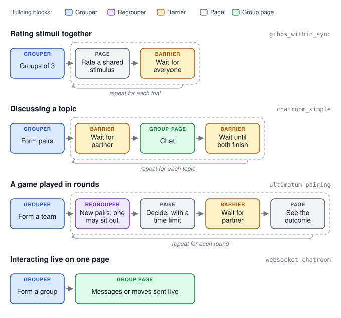

.. _concept_groups:

Groups
======

In a **group experiment**, several participants take part at the same time and
interact: they play a game against each other, rate the same stimuli together,
or talk in a chatroom. The rest of the :doc:`timeline <timeline>` stays the
same; groups add points where participants wait for each other.

Forming groups
--------------

A **grouper** in the timeline collects participants as they arrive and forms
a group once enough are waiting, for example two for a two-player game.
Participants wait on the page they are on until their group is complete. A
grouper can also wait for a larger batch and then split it into groups; the
built-in grouper splits it at random, and a custom grouper can choose the
split, for example to balance groups.

Groups are formed from whoever is online at the same moment, so recruitment
has to bring participants in close together. A participant who waits too long
without a group is failed and sent to the end of the experiment.

Keeping a group in step
-----------------------

A **barrier** makes every member of a group wait until all members have
reached it. Barriers go wherever the design needs participants to be in the
same place: before a round starts, after everyone has responded, or before
results are shown. When the last member arrives, the barrier can run code for
the whole group, such as scoring a round or assigning roles.

In a trial maker, the group can also share its trials. One member acts as the
**leader**: PsyNet picks the leader's next node as if they were taking the
trial maker alone, and the other members get trials on the same node, so
everyone sees the same stimulus in each round.

Waiting and dropouts
--------------------

Every barrier and grouper has a **maximum waiting time**. A participant who
waits longer, for example because a partner closed the browser, is released.
At a grouper they are failed; at a barrier, depending on its settings, they
are either failed or removed from the group so that they can continue alone.
A barrier can also set a time limit between barriers, which catches members
who fall behind: a member who hasn't reached the next barrier in time is
failed or removed. For a member on a page with its own time limit, this
between-barrier time counts from when the page's limit runs out. By default,
participants are credited for the actual time
they wait, up to the maximum.

Plan for dropouts: decide whether a round can continue with fewer members,
whether the remaining members should go on alone or finish early, and how
their data will be analyzed.

Games in rounds
---------------

Many group games are played in **rounds**. In each round, players are put
into new pairs or groups, make a decision, and see the outcome before the next
round starts. A **regrouper** at the start of each round splits a larger team
into that round's groups, at random or with roles such as proposer and
responder, keeping last round's partners apart where possible. If the team
doesn't divide evenly, someone **sits out** the round. They see a page saying
so and play again in a later round.

Rounds need a plan for slow players, because a player who stops responding
holds up their partners. Give decision pages a time limit. A player who runs
out of time moves on, and their partners see that they ran out of time instead
of waiting. A player who falls further behind, for example because they closed
the tab, is taken out of the round and can rejoin in the next one.

Decide when the game ends: after a fixed number of rounds, when a player has
sat out too often, or when too few players remain to form a group.

Talking to each other
---------------------

A **chatroom** lets group members exchange messages on a page. Messages are
stored with the experiment's data, so conversations can be analyzed later.

Other **real-time interaction**, such as taking turns in a game on one page,
works the same way: each member's page sends actions to the server as they
happen. The server is the authority on the shared state. It accepts or rejects
each action, for example one made out of turn, and sends the result to every
member, whose page shows only what the server sent. Decide what each member
is allowed to see, what happens when a member's connection drops or they
reload the page, and which parts of the interaction are recorded for
analysis.

Putting the pieces together
---------------------------

Most group experiments combine the same few blocks. A grouper forms groups,
barriers keep each group in step, and a regrouper forms new groups for each
round. Between them, members answer on their own pages or interact on a
**group page**, such as a chatroom. The diagram shows four common designs and
the demo that implements each one.

      together: a grouper, then each trial a barrier and a page. Discussing a
      topic: a grouper forms pairs, then a barrier, a chat and a barrier. A
      game played in rounds: a grouper forms a team, then each round a
      regrouper forms pairs, players decide with a time limit, wait for their
      partner at a barrier and see the outcome. Interacting live: players
      choose a room, then one group page sends their messages live to the
      room.

What to check when reviewing group experiments
----------------------------------------------

- Is recruitment fast enough to form groups? Waiting participants cost money
  and may leave.
- Is there a barrier everywhere members must be in step, and nowhere else?
- What happens to each remaining member when someone drops out mid-round?
- Are maximum waiting times long enough for the slowest pages, and short
  enough that participants don't give up?
- In a game played in rounds, what do a player's partners see when the
  player runs out of time?
- Is sitting out fair, and do rounds a player sits out count towards their
  total?
- In a real-time interaction, can a member see information meant only for
  others, and can the interaction resume after a reload?

.. seealso::

   :doc:`/code/multiplayer/writing_a_round_based_experiment` shows how these
   ideas appear in ``experiment.py``, using the
   ``demos/experiments/ultimatum_pairing`` demo.

   The :doc:`/skills/synchronous-experiments` skill describes how to design
   and test group experiments.

