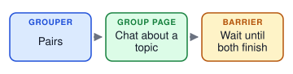
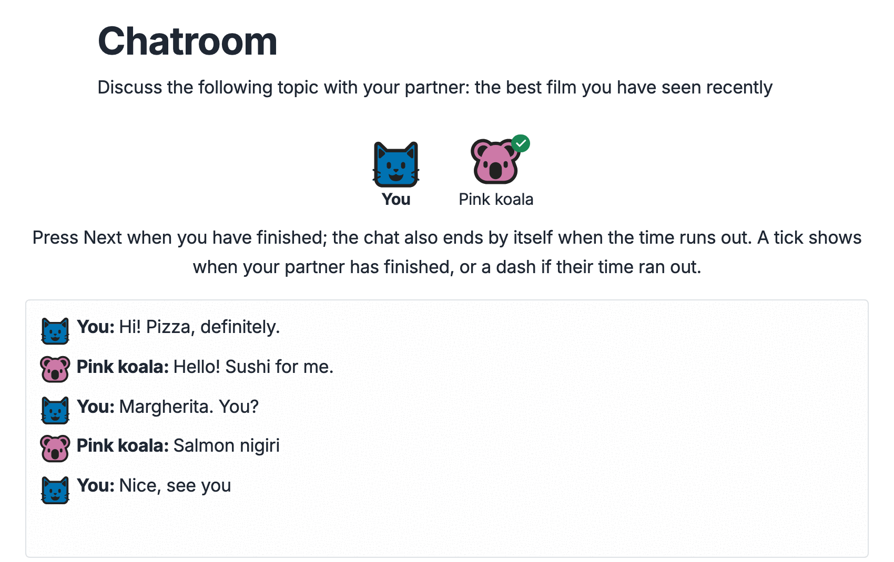
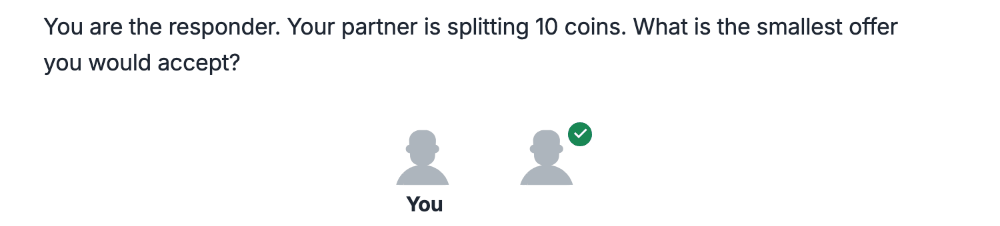
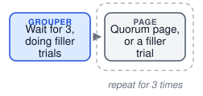

.. _concept_groups:

Groups
======

In a **group experiment**, several participants take part at the same time and
interact with each other. The rest of the :doc:`timeline <timeline>` stays the
same; groups add points where participants wait for each other.

This page covers what every group experiment has. Many groups then interact
in :doc:`rounds <rounds>` or in a :doc:`live game <live_games>`, which have
pages of their own.

How it works
------------

A group goes through the experiment like this:

1. Participants arrive one by one, and a **grouper** in the timeline collects
   them into groups.
2. Each group goes through the timeline together, and **barriers** keep its
   members in step, wherever they must all be in the same place.
3. Members interact: by chatting, in rounds of decisions, or in a live
   game.
4. They see each other by a **pseudonym**, never by their real identity.
5. Members may leave, for example by closing the tab, and in some designs
   newcomers join.
6. Each member's data records their group, and what happened to them in it.

Forming groups
--------------

A **grouper** in the timeline collects participants as they arrive and forms
a group once enough are waiting, for example two for a two-player game.
Participants wait on the page they are on until their group is complete. A
grouper can also wait for a larger batch and then split it into groups; the
built-in grouper splits it at random, and a custom grouper can choose the
split, for example to balance groups. Waiting for a larger batch gives the
grouper more choice but makes participants wait longer.

Groups are formed from whoever is online at the same moment, so recruitment
has to bring participants in close together. A participant who waits too long
without a group is failed and sent to the end of the experiment, unless you
choose to let them continue without one, for example with a task of their own.

Waiting for a full group makes the first arrivals wait longest, and a group
that loses a member early may still be worth saving. An **open lobby** lets
a group **start short**, with fewer members than it would like, once its
first member has waited long enough, and then **tops it up**: latecomers join
a group that has a free place instead of waiting for a new one. Top-ups
can stop when the game starts, so that every member plays every round;
from then on, latecomers wait for a new group. Alternatively, a group can
keep taking latecomers during the game, who wait to be admitted at the
start of the next round (see `When membership changes`_). A group
that loses a member before the game starts can also wait a little while for a
latecomer to replace them (see `When members leave`_). The ``crowd_estimate``
demo starts groups short and tops them up (see
:ref:`design-rounds-start-short`).

Keeping a group in step
-----------------------

A **barrier** makes every member of a group wait until all members have
reached it. Barriers go wherever the design needs participants to be in the
same place: before a round starts, after everyone has responded, or before
results are shown. When the last member arrives, the barrier can run code for
the whole group, such as scoring a round or assigning roles. For rounds of
cued trials, where a barrier's release also closes the round, see
:ref:`rounds-cued-trials`.

How members interact
--------------------

Members of a group interact in three ways, and an experiment can use more
than one:

- **In a chatroom**, where members exchange messages as they write them. The
  messages are stored with the experiment's data, so conversations can be
  analyzed later. In `chatroom_simple <https://gitlab.com/PsyNetDev/PsyNet/-/tree/master/demos/experiments/chatroom_simple>`__, pairs
  discuss a topic, and a barrier after the chat waits until both have
  finished. Other real-time pages that aren't games, such as editing a
  shared answer, can be built from WebSocket messages (see
  :doc:`/code/multiplayer/realtime_interaction`).
- **In rounds**, where each member decides on their own page, a barrier waits
  for all of them, and then everyone sees the result. Economic games, rating
  stimuli together and taking turns work this way, at the pace of the
  slowest member. :doc:`rounds` describes them.
- **In a live game**, where the members stay on one page, and each move
  reaches the others as soon as it's made, so players can react to each
  other while they act, as in a negotiation or a game on a shared board.
  :doc:`live_games` describes them.

Seeing who you're playing with
------------------------------

Group members see each other by a **pseudonym**, such as "Pink koala", drawn
as an animal in a colour, never by their real identity:

      partner "Pink koala", each with their animal next to their messages.

A participant keeps the same pseudonym for the whole experiment, so when
groups change from round to round, players can recognise someone they met
before. If that could change how they behave, for example because a player
could build a reputation in a game, show members **anonymously** instead:
everyone appears as the same grey figure.

      identical grey figures, one labelled "You".

The dashboard shows each participant's pseudonym, and the names that
participants saw can be recovered from an export, for example to read chat
messages that mention them (see :doc:`/code/multiplayer/pseudonyms`).

When members leave
------------------

Participants leave groups in several ways, and PsyNet learns of each in a
different way:

.. list-table::
   :header-rows: 1
   :widths: 28 36 36

   * - The participant…
     - When PsyNet acts
     - What you decide
   * - returns the study on the recruitment platform, or is failed by the
       experiment, for example for a failed check
     - At once: they are failed and leave their group.
     - Whether the others carry on without them.
   * - closes the tab or stops responding
     - Only when a time limit runs out. Either they are **late**: they
       haven't reached the next barrier within a set number of seconds. Or
       the members waiting for them at a barrier reach its **maximum waiting
       time**.
     - Whether the late member, or the members who waited, are failed or
       continue the experiment without the group.
   * - comes back after being removed from the group
     - A notice tells them what happened, and they continue the experiment
       without the group.
     - What they do for the rest of the experiment: a task on their own, an
       early end, or a new group.
   * - arrives when no group can form
     - When they have waited at the grouper for its maximum waiting time:
       they are failed, or continue without a group.
     - Whether a smaller group may start instead, whether they may join a
       group that has lost a member, and whether those left over are failed
       or continue on their own.

A member on a page with its own time limit is not late before the page's time
limit has run out. By default, participants are credited for the actual time
they wait, up to the maximum.

When someone leaves, a group that still has its **quorum**, the smallest
size at which it can go on, carries on. Below it, the group either waits
for a newcomer or is dissolved, and the grouper's ``below_quorum`` decides
for those left: with ``below_quorum="fail"`` they are failed too, and with
``below_quorum="continue_without_group"`` they continue the experiment
without the group (see :ref:`groups_below_quorum`). Decide this for every
grouper; PsyNet requires it for groups designed to shrink, such as those
with a quorum below their size or whose barriers remove late members. Failed
participants are paid for what they completed (see
:doc:`/code/participants/payment`).

A group that needs a quorum for only part of the experiment can let its
members do something else while it waits. In
`sync_quorum <https://gitlab.com/PsyNetDev/PsyNet/-/tree/master/demos/experiments/sync_quorum>`__, everyone joins one growing group, and
part of the experiment only opens while at least three members are present.
Until then, and whenever the group drops below three, members do filler
trials instead of waiting.

When membership changes
-----------------------

Some designs study what a group passes on while its members are replaced,
for example whether a society's knowledge outlives its founders. The group
takes newcomers for as long as it lasts. In rounds, a newcomer doesn't join in
the middle of a round: they become a **pending member**, who holds a seat but
whom nobody waits for, until the group reaches an **admission point**, such
as the barrier that starts the next round (see :ref:`sync-admission-points`).
A newcomer who isn't admitted in time is turned away, not failed. A live
game can instead take newcomers while it runs.

The ``microsociety`` demo replaces its members round after round (see
:ref:`design-rounds-society`), and ``microsociety_live`` does it during one
continuous game.

Where the data goes
-------------------

Each member's link to their group is saved with the experiment's data: when
they arrived, their role, when they were admitted, and when and why they left
the group, such as being late or the group being dissolved. Chat messages are
saved with the participant who sent each one, and the pseudonyms that
participants saw can be recovered from an export (see
:doc:`/code/multiplayer/pseudonyms`). What the group did together is saved
with its rounds or its live games, as their pages describe.

What to check when reviewing group experiments
----------------------------------------------

- Is recruitment fast enough to form groups? Waiting participants cost money
  and may leave.
- Is there a barrier everywhere members must be in step, and nowhere else?
- What happens to each remaining member when someone drops out, and how
  will their data be analyzed?
- Are maximum waiting times long enough for the slowest pages, and short
  enough that participants don't give up?
- In a real-time interaction, can a member see information meant only for
  others, and can the interaction resume after a reload?
- Can players recognise each other from one group or round to the next, and
  should they?

:doc:`rounds` and :doc:`live_games` have checks of their own.

.. seealso::

   :doc:`/code/multiplayer/synchronization` shows how groups and barriers
   appear in ``experiment.py``.

   The :doc:`/skills/synchronous-experiments` skill describes how to design
   and test group experiments.
