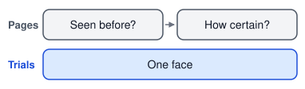

Trials and pages
================

A :doc:`trial <trials>` records one participant's encounter with a stimulus.
A :doc:`page <pages>` is a step on the participant's timeline. How the two
fit together depends on what you want to measure and what the participant
should do next.

One page per trial
------------------

In a music-rating study, a participant listens to a song excerpt and rates
how much they like it. That rating completes the trial. The next page plays
another song.

.. figure:: ../_static/images/design/trials/music_ratings.svg
   :alt: Two successive rating pages, each paired with a trial for its own song.

Use one page per trial when the participant can give their whole response
to a stimulus on one screen. PsyNet normally updates the screen in place
as the timeline advances, so moving to the next song doesn't require
a browser reload.

Several pages per trial
-----------------------

In a recognition study, a participant sees a face and decides whether they
have seen it before. Once they commit to an answer, the face disappears.
A second page asks how confident they are.

Use several pages when the order of the responses matters. Here, asking
about confidence on a second page lets you measure certainty about a decision
the participant has already made. Both responses can be kept together in
the trial for that face.

Several trials on one page
--------------------------

In an art-sorting task, a participant swipes paintings left or right. As one
painting follows their finger off screen, the next slides into view beneath
it. Each swipe records a response to one painting.

.. figure:: ../_static/images/design/trials/art_sorting.svg
   :alt: One continuous sorting page spans three trials, one for each painting.

A single live page is usually the best choice for a fast-paced task where
you need to minimise the delay between a response and the next stimulus. If the
deck is ready in the browser, the next painting can appear as soon as the
participant swipes. The timeline advances once, at the end of the round.
If PsyNet needs the answer to select the next painting, the page still has
to wait for that choice.

The trade-off is that you build more of the front end yourself. In this
task, you handle the swipe, animate the painting and decide when the next
one is ready for input. Ordinary pages can also keep the interface on screen
as the timeline advances. They take less work when a built-in control and
a page submission per response suit the pace of your task.

.. seealso::

   :doc:`/code/writing_a_trial_maker` covers trials with one or more pages.
   :doc:`/code/trials/keeping_a_task_on_one_page` covers prepared and adaptive
   sequences on a live page.
