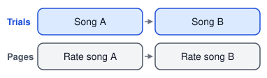
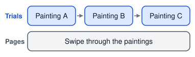

Trials and pages
================

A :doc:`trial <trials>` records one participant's response to a stimulus.
A :doc:`page <pages>` is one screen of the participant's timeline. Usually
each trial gets its own page, but a trial can span several pages, and several
trials can share one page. Which suits your task depends on what you want to
measure and how quickly the participant should move on.

One page per trial
------------------

In a music-rating study, a participant listens to a song excerpt and rates
how much they like it. That rating completes the trial. The next page plays
another song.

Use one page per trial when the participant can give their whole response
to a stimulus on one screen. PsyNet normally updates the screen in place
as the timeline advances, so moving to the next song doesn't require
a browser reload.

Several pages per trial
-----------------------

In a recognition study, a participant sees a face and decides whether they
have seen it before. Once they commit to an answer, the face disappears.
A second page asks how confident they are.

.. figure:: ../_static/images/design/trials/face_recognition.svg
   :alt: A recognition page followed by a confidence page. One trial spans both pages for the same face.

Use several pages when the order of the responses matters. Asking about
confidence on a second page measures certainty about a decision the
participant has already made. The trial for that face keeps both responses.

Several trials on one page
--------------------------

In an art-sorting task, a participant swipes paintings left or right. As one
painting follows their finger off screen, the next slides into view beneath
it. Each swipe records a response to one painting.

Keep several trials on one page when the task is fast and the interface
should stay put between responses. Each trial still has a page of its own,
but the pages share one layout and answer from the page's JavaScript, so only
the painting changes. Each swipe goes to the server, which records it and
sends the next painting, usually within a fraction of a second, depending on
the participant's connection. Because the paintings come in a fixed order, the
trial maker can also send the next few paintings ahead, so that the next one
appears at once while the server records the swipe.

The cost is that you write more of the interface yourself. Here, you would
handle the swipe, animate the painting and decide when the next one can take
input. If a built-in control and one page submission per response are fast
enough for your task, ordinary pages are less work, and they can keep the
interface on screen between trials.

.. seealso::

   :doc:`/code/writing_a_trial_maker` shows how to give a trial one or more
   pages. :doc:`/code/trials/keeping_a_task_on_one_page` shows how to present
   a fixed or adaptive sequence of trials on one page.
