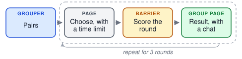
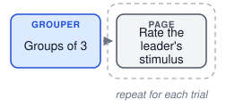
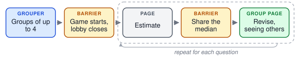
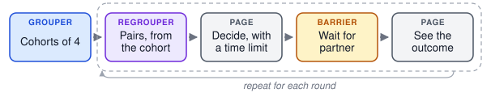
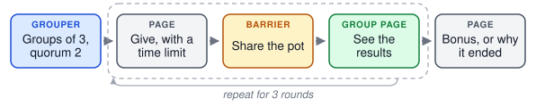

.. _design-rounds:

Round-based experiments
=======================

Many group experiments are played in **rounds**: each member decides on their
own page, the group waits until everyone has, and then everyone sees the
result, round after round. This page describes how rounds work, how
partners can change from round to round, and what to do about slow players.
:doc:`groups` covers what every group experiment needs, such as forming
groups and handling dropouts.

How it works
------------

A round goes like this:

1. Each member of the group makes their decision on their own page, usually
   with a time limit.
2. A **barrier** waits until every member has decided.
3. When the last member arrives, the barrier can run code for the whole
   group, such as scoring the round, sharing the pot or counting the votes.
4. Everyone sees the round's result, and the next round starts.

Each member's decision in a round is a trial, so it's saved like any other
trial's answer. The members' trials in one round share a record of the
group's round, which holds what the group did together, such as the pot.

.. _design-rounds-cued-or-synced:

Cued trials or a synchronized trial maker
-----------------------------------------

A group's rounds can be run in two ways, as **cued trials** or by a
**synchronized trial maker**:

.. list-table::
   :header-rows: 1
   :widths: 34 40 26

   * - The design
     - Use
     - Demos
   * - A game played in rounds without a stimulus set, such as an economic
       game, with the same group or new partners every round
     - **Cued trials**: a loop in the timeline with one
       :meth:`Trial.cue() <psynet.trial.main.Trial.cue>` per player in each
       round. If partners change between rounds, a regrouper comes first in
       each round (see `Changing partners between rounds`_). The trials of
       a group's round share a
       :class:`~psynet.sync.SyncGroupRound` that holds the group's results.
     - `public_goods <https://gitlab.com/PsyNetDev/PsyNet/-/tree/master/demos/experiments/public_goods>`__,
       `ultimatum_pairing <https://gitlab.com/PsyNetDev/PsyNet/-/tree/master/demos/experiments/ultimatum_pairing>`__,
       `story_chain <https://gitlab.com/PsyNetDev/PsyNet/-/tree/master/demos/experiments/story_chain>`__,
       `microsociety <https://gitlab.com/PsyNetDev/PsyNet/-/tree/master/demos/experiments/microsociety>`__
   * - A group working through a stimulus set or a chain together, each
       member getting a trial on the same stimulus
     - **A synchronized trial maker**: a trial maker with a group type
       (``sync_group_type``), which gives the members trials on the same
       nodes and keeps them in step from trial to trial. Each time it
       prepares the group's trials, they share a new
       :class:`~psynet.sync.SyncGroupRound`.
     - `create_rate_sync <https://gitlab.com/PsyNetDev/PsyNet/-/tree/master/demos/experiments/create_rate_sync>`__,
       `gibbs_within_sync <https://gitlab.com/PsyNetDev/PsyNet/-/tree/master/demos/experiments/gibbs_within_sync>`__

In a trial maker, the group can also share its trials. One member acts as the
**leader**: PsyNet picks the leader's next node as if they were taking the
trial maker alone, and the other members get trials on the same node, so
everyone sees the same stimulus in each round.

Changing partners between rounds
--------------------------------

New groups for each round
~~~~~~~~~~~~~~~~~~~~~~~~~

Many economic games give players a new partner every round, so that each
player meets several others, and nobody can build a reputation with one
partner or pay them back in the next round: in an ultimatum game, for
example, each round's proposer faces a responder they haven't met. Other
designs change groups only once, such as from discussing in threes to
bargaining in pairs.

To change groups once, end the first groups at a step that all their members
reach, a *group closer*, and form the new groups with a second grouper (see
:ref:`sync-regrouping`).

To give players new partners every round, start each round with a
*regrouper*. Each time players reach it, it takes them out of their previous
group and splits those waiting into new groups at random, giving out roles,
such as proposer and responder, at random too. It doesn't split them as soon
as two are waiting, which would pair whoever finished at the same moment,
often the same people every round: it collects players and splits them at a
deadline, for example every 10 seconds (``every=10``). With
``avoid_repeats=True`` it keeps players apart from last round's partners
when it can, and with ``keep_roles=True`` each player keeps the role of their
first group, for example a proposer who stays a proposer.

If the players don't divide evenly into groups, the one who has played the
most rounds (with ``keep_roles``, of the same role) *sits out* the round:
they see a page saying so, and play again
in a later round. A player who is late for a split joins the next one. If no
further split comes within the regrouper's maximum waiting time, for example
after the last round, they are failed by default
(``max_wait_action="fail"``), unless the regrouper lets them continue without
a group (``max_wait_action="continue_without_group"``).

Cohorts that regroup each round
~~~~~~~~~~~~~~~~~~~~~~~~~~~~~~~

When a regrouper splits everyone waiting, who a player can meet depends on
how busy the experiment is: at a busy moment their partner is drawn from
eight players, at a quiet one from two. Experimental economists keep this the
same for everyone with *matching groups*: a fixed set of players, say four,
whose members are paired with each other every round, and never with anyone
else. In PsyNet, a grouper first forms these **cohorts**, which stay together
for the whole game, and the regrouper then splits each cohort into new groups
every round.
Because the regrouper knows who is in the cohort, a round can start as soon as
the whole cohort is back; the deadline only matters when someone is missing.

Slow players
------------

Rounds need a plan for slow players, because a player who stops responding
holds up their partners. Give decision pages a time limit. A player who runs
out of time moves on, and their partners see that they ran out of time instead
of waiting. A player who falls further behind, for example because they closed
the tab, is late at the barrier after the decision. Usually, fail them: a
failed participant's contribution is no longer useful, so their session
ends promptly, and they are paid for what they completed. Their partners
carry on where the design allows. In ``ultimatum_pairing``, the partner of
a player failed this way is released alone and paired again in the next
round; in a fixed group, the others carry on while the group keeps its
quorum. Letting the late player carry on without their group is an
advanced option, for designs where that is meaningful.

After any barrier, a partner may be gone, so a page that uses a partner's
input must handle it being missing (see
:ref:`late-remaining-players`).

Decide when the game ends: after a fixed number of rounds, when a player has
sat out too often, or when too few players remain to form a group.

See :doc:`/code/multiplayer/late_slow_and_leaving_players` for worked
examples of each case.

Where the data goes
-------------------

Each trial records the group, the player's role and the round,
and how the round ended for the player (``trial.sync_group_outcome``), so
the data can be analyzed round by round. A group's rounds can be read back
in order with :meth:`SyncGroup.rounds() <psynet.sync.SyncGroup.rounds>`.

Examples
--------

Each diagram shows a demo's timeline as a sequence of blocks; a dashed box
repeats. Several also have a demo played as a :doc:`live game <live_games>`.
:doc:`/demos/index` lists every demo.

The same partners every round
~~~~~~~~~~~~~~~~~~~~~~~~~~~~~

In `rock_paper_scissors <https://gitlab.com/PsyNetDev/PsyNet/-/tree/master/demos/experiments/rock_paper_scissors>`__, the same pair plays three rounds.
Each player chooses within a time limit, a barrier scores the round, and both
see the result. Rounds don't need new groups when partners stay the same.

Played live, in `rock_paper_scissors_live <https://gitlab.com/PsyNetDev/PsyNet/-/tree/master/demos/experiments/rock_paper_scissors_live>`__,
the pair plays two games on one page, each throw shown to both as soon as
both have chosen.

In `create_rate_sync <https://gitlab.com/PsyNetDev/PsyNet/-/tree/master/demos/experiments/create_rate_sync>`__, each member of a group of three
writes an answer, then rates the others' answers, and the group sees which
answer won. One barrier waits until all answers are in, and another counts the
votes.

In `story_chain <https://gitlab.com/PsyNetDev/PsyNet/-/tree/master/demos/experiments/story_chain>`__, a group of three writes a story one
sentence at a time, taking turns in seat order. While one member writes, the
others wait at a barrier that shows them the story so far. The writer's
sentence is stored on the turn as soon as they submit it. A writer who runs
out of time adds nothing that turn; a member who leaves plays no more turns,
and the next member in seat order writes in their place. The last one left
is failed, because nobody writes a group story alone.

A shared chain of stimuli
~~~~~~~~~~~~~~~~~~~~~~~~~

In `gibbs_within_sync <https://gitlab.com/PsyNetDev/PsyNet/-/tree/master/demos/experiments/gibbs_within_sync>`__, a group of three shares a chain of
stimuli. The leader's next stimulus is chosen as if they were taking the
experiment alone, and everyone rates that same stimulus. Newcomers can join a
group that has lost members; each is admitted when the group's next trial is
prepared, which is an admission point.

.. _design-rounds-start-short:

Groups that start short
~~~~~~~~~~~~~~~~~~~~~~~

In `crowd_estimate <https://gitlab.com/PsyNetDev/PsyNet/-/tree/master/demos/experiments/crowd_estimate>`__, groups of up to four play a
wisdom-of-crowds game; a group of three may start after a short wait. For
each of two questions, every member estimates the answer, a barrier shares
the group's median, and members see everyone's estimate and may revise their
own. A group needs three members, because the median of two estimates is
just their mean, so the group's quorum is three. A member who stops
responding is failed, and the others carry on while at least three remain.
Nobody answers alone: a participant who finds no group, or whose group
falls below three, is failed too.

age that shows everyone's estimate.

Pairs from a cohort
~~~~~~~~~~~~~~~~~~~

In `ultimatum_pairing <https://gitlab.com/PsyNetDev/PsyNet/-/tree/master/demos/experiments/ultimatum_pairing>`__, a grouper forms cohorts of four,
or of two or three once the first player has waited a minute. Each round, the
regrouper splits the cohort into pairs of a proposer and a responder. The
proposer offers part of 10 coins, and the responder accepts or rejects the
offer. A latecomer can join a cohort that started short, and is admitted at
the next split, which is an admission point. A player who stops responding
is failed, and their partner is paired again at the next split.

Played live, in `bargaining_live <https://gitlab.com/PsyNetDev/PsyNet/-/tree/master/demos/experiments/bargaining_live>`__, each round's
pairs bargain for up to a minute: either player can propose a split at any
time, and either can accept the other's.

.. _design-rounds-carry-on:

Carrying on when members leave
~~~~~~~~~~~~~~~~~~~~~~~~~~~~~~

In `public_goods <https://gitlab.com/PsyNetDev/PsyNet/-/tree/master/demos/experiments/public_goods>`__, a group of three plays three rounds.
Each round, every player privately puts some of their tokens in a shared pot,
within a time limit; the pot grows by half and is shared between the players
of that round, who then see everyone's contributions and what they earned,
paid as a bonus. A player who runs out of time puts nothing in, but keeps
their tokens and their share. A player who returns the study or stops
responding is failed and earns nothing for that round, and the other
two carry on and share the pot between them. When only one player is left,
that round is cancelled and that player is failed too, as is a participant
for whom no group formed; failed participants are paid for the rounds they
completed.
Each round is one trial per player that pays that round's bonus, so the data
and the payments agree.

Played live, in `public_goods_live <https://gitlab.com/PsyNetDev/PsyNet/-/tree/master/demos/experiments/public_goods_live>`__, each
member sees the others' contributions as they change, and can change their
own until the round's time is up.

.. _design-rounds-society:

A society whose members change
~~~~~~~~~~~~~~~~~~~~~~~~~~~~~~

In `microsociety <https://gitlab.com/PsyNetDev/PsyNet/-/tree/master/demos/experiments/microsociety>`__, three players
form a fishing society that plays round after round. Each round, every
member picks a fishing spot and catches some fish, a barrier scores the round, and everyone sees where
the others fished and what they caught. A newcomer is admitted at the start
of a round, where they see the society's recent catches and the tips left by
earlier members. When a newcomer has made the society four, its
longest-serving member retires at the end of the round. Members also stop
after six rounds, and leave a tip for future members before they go.

es all catches. Finally each member leaves a tip.

Played live, in `microsociety_live <https://gitlab.com/PsyNetDev/PsyNet/-/tree/master/demos/experiments/microsociety_live>`__, the
society fishes on one lake without rounds: newcomers sail on while the
others fish, and each member leaves in their own time.

What to check when reviewing round-based experiments
----------------------------------------------------

- What do a player's partners see when the player runs out of time, or is
  failed for being late? Does every page after a barrier handle a partner's
  input being missing?
- Is sitting out fair, and do rounds a player sits out count towards their
  total?
- Does each round's record hold what the analysis needs from the group?

.. seealso::

   :doc:`/code/multiplayer/writing_a_round_based_experiment` shows how these
   ideas appear in ``experiment.py``, using the
   ``demos/experiments/ultimatum_pairing`` demo.
